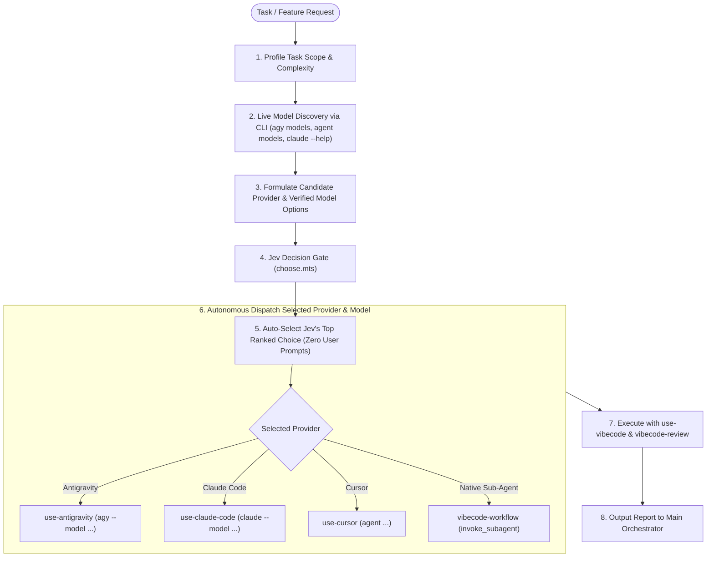

# Auto-Mode Workflow

## Overview

A smart routing and dispatch workflow that matches each development task to the **most proportional AI provider and model tier**. 

Instead of treating every task with the same heavy, expensive model or guessing which CLI tool to invoke, `auto-mode-workflow` passes candidate execution options through **TypeSafe's Jev model** (via `jev-assistance`). Jev scores each provider + model pair on fit, simplicity, safety, and reliability, picking the optimal combination automatically or prompting the user when the choice is high-stakes.



---

## Why Use Auto-Mode Workflow?

### 1. Eliminating "Overkill" on Small Tasks
When a change is modest ("works not much" — e.g. updating a CSS opacity property, adding a missing prop, tweaking a regex, or fixing a typo), launching a heavy containerized sandbox with maximum reasoning effort costs unnecessary time, tokens, and latency. A fast, lightweight model (e.g. Gemini Flash, Claude Haiku) gets the job done in seconds.

### 2. Ensuring Sufficient Power on Complex Work
When a task involves multi-file refactoring, state management, or architecture changes, a lightweight model will struggle or produce subtle bugs. Jev automatically identifies that higher reasoning power (e.g. Claude Sonnet, Gemini Pro) is required to satisfy the fit and reliability criteria.

### 3. Objective, Probability-Backed Routing
Rather than hardcoding rigid `if/else` rules, Jev evaluates the actual task description, stack context, and constraints to compute probability scores across multiple dimensions:
- `fit`: Does this model/tool have the capability to solve the problem?
- `simplicity`: Does this avoid unnecessary operational overhead and cost?
- `safety`: Is the execution environment safe, reversible, and contained?
- `reliability`: How dependably will this model adhere to the project's rules?

## Manual Configuration: `config.json`

The skill contains a customizable [`config.json`](./config.json) that controls provider enablement, model overrides, and interactive behavior.

```json
{
  "routing": {
    "mode": "auto",                    // "auto" (unattended), "ask" (prompt user), "threshold"
    "confidence_threshold": 0.6,       // Jev confidence threshold
    "cost_preference": "prefer_fast_and_cheap", // "prefer_fast_and_cheap" | "balanced" | "deep_reasoning"
    "allow_interactive_prompts": false // false = strictly no modals; true = allows user prompts
  },
  "overrides": {
    "force_provider": null,            // e.g. "antigravity", "claude_code", "native_subagent"
    "force_model": null                // e.g. "gemini-3.8-flash-medium", "sonnet"
  },
  "monitoring": {
    "live_progress_artifact": true,    // maintains a live dashboard artifact in side panel
    "artifact_filename": "task-progress.md"
  },
  "providers": {
    "native_subagent": { "enabled": true, "models": { "light": "flash", "heavy": "pro" } },
    "antigravity": { "enabled": true, "cli_command": "agy", "models": { "light": "gemini-3.8-flash-medium", "heavy": "claude-sonnet-5-5-medium" } },
    "claude_code": { "enabled": true, "cli_command": "claude", "models": { "light": "haiku", "heavy": "sonnet" } },
    "cursor": { "enabled": true, "cli_command": "agent", "models": { "light": "default", "heavy": "advanced" } }
  },
  "fallback": {
    "auto_fallback_on_429": true,
    "priority_order": ["native_subagent", "antigravity", "claude_code", "cursor"]
  }
}
```

### Key Configuration Controls
1. **Live Monitoring**: `"live_progress_artifact": true` tells the orchestrator to pin a real-time progress dashboard artifact in the user's IDE side panel.
2. **Enable/Disable Providers**: Set `"enabled": false` under any provider to prevent Jev from considering it.
3. **Force Overrides**: Set `"force_provider": "antigravity"` to bypass Jev completely and pin a specific tool.
4. **Allow Prompts**: If you *want* interactive dialogs, set `"allow_interactive_prompts": true`. By default it is `false` to prevent unwanted modals.
5. **Custom Fallback Priority**: Customize `"priority_order"` to control which provider takes over when HTTP 429 occurs.

---

## Live Monitoring: The Side-by-Side Dashboard Artifact

When `monitoring.live_progress_artifact` is enabled (default), the Main Agent creates and updates a dedicated markdown artifact in `<appDataDir>/brain/<conversation-id>/task-progress.md`. 

Because it is a rendered Artifact, it opens in a side pane next to the code and updates **live in place** without flooding the conversation history with spammy log messages.

### Dashboard Artifact Template
```markdown
# 🚀 Task Dashboard: <Task Name>

| Field | Current Status |
| :--- | :--- |
| **Active Phase** | `[▶] STAGE 2: WORKER EXECUTING` |
| **Selected Provider** | `Antigravity CLI (agy)` |
| **Selected Model** | `gemini-3.8-flash-medium` |
| **Jev Decision** | Auto-picked (Confidence: `0.92`) |
| **Elapsed / Status** | Working on in-place edits |

---

### Progress Checklist
- [x] **Stage 1: Task Scoping**: Evaluated task complexity and constraints.
- [x] **Stage 2: Pre-Flight & Discovery**: Verified authentication and live models.
- [x] **Stage 3: Jev Decision Gate**: Chose most proportional provider & model.
- [▶] **Stage 4: Worker Execution**: Worker editing code adhering to `vibecode`.
- [ ] **Stage 5: Vibecode Review Gate**: Mandatory compliance audit against disk.
- [ ] **Stage 6: Final Verification**: Builds & unit tests passing.

---

### Working Files & Changes
- `src/components/dialog/liquid-dialog.scss` (modified)
- `src/components/dialog/liquid-dialog.ts` (modified)

### Audit & Review Verdict
- [x] Code Search before create: PASS
- [x] In-place edits, no dead code: PASS
- [ ] Design Tokens applied: PENDING
- [ ] Final Verdict: `IN_PROGRESS`
```

---

## Step-by-Step Procedure

### Stage 1: Configuration & Task Scoping (Main Agent)

1. **Read `config.json`**:
   - Check `overrides`: if `force_provider` is set, bypass Jev and proceed directly to dispatching that provider with `force_model`.
   - Check `providers`: filter candidate providers so only those with `"enabled": true` are evaluated.
   - Note `routing.allow_interactive_prompts`: controls whether user modals are permitted if Jev requests input.
2. **Review the User Request**:
   - Understand the task scope and requirements from the user's prompt.
   - Note key parameters:
     - **Magnitude**: Minor (1-2 files, direct edit), Moderate (component/service), Major (cross-cutting refactor, migration).
     - **UI / Design**: Does it touch styling or components (`vibecode-design` applies)?
     - **Runtime constraints**: Does the task require running commands, tests, or Docker sandboxes?

> [!IMPORTANT]
> As established in `vibecode-workflow`, the Main Agent must **not** investigate implementation files or grep the codebase. Frame the candidate options based strictly on the user's high-level description.

---

### Stage 2: Pre-Flight Check (Auth, Session Limits & Model Discovery)

Before asking Jev to judge providers, verify that the candidates are **logged in**, **within session limits**, and **query real models**:

#### 1. Authentication & Login Verification
Never propose a provider that is not logged in:
- **Claude Code**: Run `claude auth status` $\rightarrow$ verify `"loggedIn": true`. If `false`, exclude Claude from options.
- **Cursor Agent**: Run `agent about` $\rightarrow$ verify valid email and subscription tier. If unauthorized, exclude Cursor.
- **Antigravity CLI**: Run `agy models` $\rightarrow$ if exit code is `0`, the CLI is authenticated. If non-zero, exclude `agy`.
- **Native Sub-Agent**: Inherent to the active IDE session (always authenticated).

#### 2. Session Quota & Rate Limit Awareness
- If a provider has hit a rate limit (e.g., Claude Code 5-hour rolling limit, HTTP 429, or Cursor monthly limit), add that constraint into Jev's `context`:
  ```json
  "context": "Claude Code is currently rate-limited (429); exclude Claude options."
  ```
- Jev will automatically avoid rate-limited providers.

#### 3. Real Supported Model Discovery
Query currently active models from the authenticated CLIs:
- **Antigravity CLI**: `agy models` *(e.g., `gemini-3.8-flash-medium`, `claude-sonnet-5-5-medium`, etc.)*
- **Cursor Agent**: `agent models` *(or `agent --list-models`)*
- **Claude Code**: `claude --help | grep -A 4 -i "\-\-model"` *(aliases: `haiku`, `sonnet`, `opus`)*
- **Native Harness Sub-Agent (`invoke_subagent`)**: `flash_lite`, `flash`, `pro`, `inherit`.

#### 4. Select 2 to 4 Live Candidates
Categorize into:
- **Fast / Lightweight Tier** (for small edits / "works not much"): e.g., `gemini-3.8-flash-medium`, `haiku`, or subagent `flash`.
- **Deep Reasoning Tier** (for complex architecture / multi-file changes): e.g., `claude-sonnet-5-5-medium`, `gemini-4-argon-medium`, `sonnet`, or subagent `pro`.

---

### Stage 3: Jev Decision Gate

1. Construct the options array using the **verified, live model names** discovered in Stage 2.
2. Pipe the structured request into `choose.mts`:

```bash
node .agents/skills/jev-assistance/scripts/choose.mts <<'JSON'
{
  "goal": "Fix opacity property on dialog component so body is configurable or not opaque",
  "context": "Project uses Angular and SCSS. Task is a localized styling fix touching 1-2 component files.",
  "question": "Which provider and model tier should execute this task?",
  "options": [
    {
      "label": "Antigravity (gemini-3.8-flash-medium)",
      "description": "Fast, cheap, lightweight edit using Antigravity CLI."
    },
    {
      "label": "Native Subagent (flash)",
      "description": "Fast ephemeral worker directly in current harness context."
    },
    {
      "label": "Claude Code (sonnet)",
      "description": "Deep reasoning Claude Code session in Docker sandbox."
    }
  ]
}
JSON
```

3. Interpret the Jev output (Zero User Prompting):

> [!IMPORTANT]
> **STRICTLY FORBIDDEN: Do NOT call `ask_question` or show choice dialogs.**
> The defining contract of `auto-mode-workflow` is **unattended automation**. Presenting a multiple-choice question modal to the user defeats the entire purpose of auto-mode.
> - **If `decision: "auto"`**: Take `pick` and dispatch immediately.
> - **If `decision: "ask"`**: Take Jev's top-ranked recommendation (`ranking[0].label`). Do **NOT** interrupt the user with a prompt.
> - **Chat Log Only**: State the decision in one regular chat line and start execution immediately:
>   `⚡ Auto-Mode: Selected "<pick>" based on Jev recommendation (<reason>). Dispatching worker...`

---

### Stage 4: Dispatch Worker with Vibecode Lifecycle

Once the provider and model are determined, dispatch the worker according to that provider's skill:

#### Option A: Native Sub-Agent (`vibecode-workflow`)
If Jev picks the native harness sub-agent:
- Set `Model: "flash"` (for light tier) or `Model: "pro"` (for heavy tier).
- Use the standard `vibecode-workflow` brief requiring `use-vibecode` and `vibecode-review`.

#### Option B: Claude Code CLI (`use-claude-code`)
If Jev picks Claude Code:
- Run in background with the selected model:
  ```bash
  claude --model <selected-model> -p --permission-mode acceptEdits --output-format stream-json "$(cat brief.txt)" > run.ndjson 2>&1
  ```
- Ensure the brief instructs Claude to follow `use-vibecode`.

#### Option C: Antigravity CLI (`use-antigravity`)
If Jev picks Antigravity CLI:
- Run in background with the selected model:
  ```bash
  agy --model <selected-model> --mode accept-edits --output-format stream-json -p "$(cat brief.txt)" > run.ndjson 2>&1
  ```

#### Option D: Cursor Agent (`use-cursor`)
If Jev picks Cursor:
- Run Cursor's agent CLI with the brief.

---

#### Fallback on Session Limit or Rate Limit (HTTP 429)
If the dispatched provider fails due to hitting a session rate limit, token cap, or quota exhaustion:
1. Do not re-analyze code or start over.
2. Inspect Jev's `ranking` array returned in Stage 3.
3. Automatically fall back to the **second-ranked option in Jev's `ranking`**.
4. Dispatch the fallback worker with the same brief.
5. Notify the user: `Dispatched provider hit rate limit. Automatically falling back to Jev's #2 pick: "<fallback-pick>"`.

---

### Stage 5: Review Gate & Handoff

Regardless of which provider and model executed the task:
1. **Mandatory Audit Gate**: The worker must have executed `vibecode-review` and produced a `[PASS]` verdict.
2. **Collect Results**: Receive the diff summary and test results from the worker.
3. **Record Jev Report**: Follow the `afterTask` instruction from `jev-assistance` to append Jev's decision log to the final report.
4. **Present to User**: Deliver the final summary with confidence scores and verification evidence.

---

## Common Mistakes

| Mistake | Correction |
|---|---|
| Calling `ask_question` to ask user to choose provider/model | **STRICTLY FORBIDDEN.** Auto-mode must execute autonomously using Jev's top pick without popping interactive choice modals |
| Proposing providers that are not logged in | Run `claude auth status`, `agent about`, and `agy models` in Stage 2 to exclude unauthenticated tools |
| Halting the workflow when a provider hits 429 / rate limits | Automatically fall back to the next ranked provider in Jev's `ranking` array |
| Hardcoding static or obsolete model names in Jev options | Always query the CLI (`agy models`, `agent models`, `claude --help`) in Stage 2 to discover real, supported models before calling Jev |
| Always using the largest reasoning model for trivial edits | Use Jev to route minor tasks to fast/light models to save time and reduce token bloat |
| Choosing provider without consulting Jev | Run `choose.mts` to get an objective, probability-weighted recommendation |
| Forgetting to enforce `use-vibecode` in the dispatched worker | Regardless of which provider is picked, the task brief must mandate `use-vibecode` and `vibecode-review` |
| Main agent inspecting code before Jev decision | Keep Main agent clean; evaluate task magnitude strictly from user prompt and repo structure |

