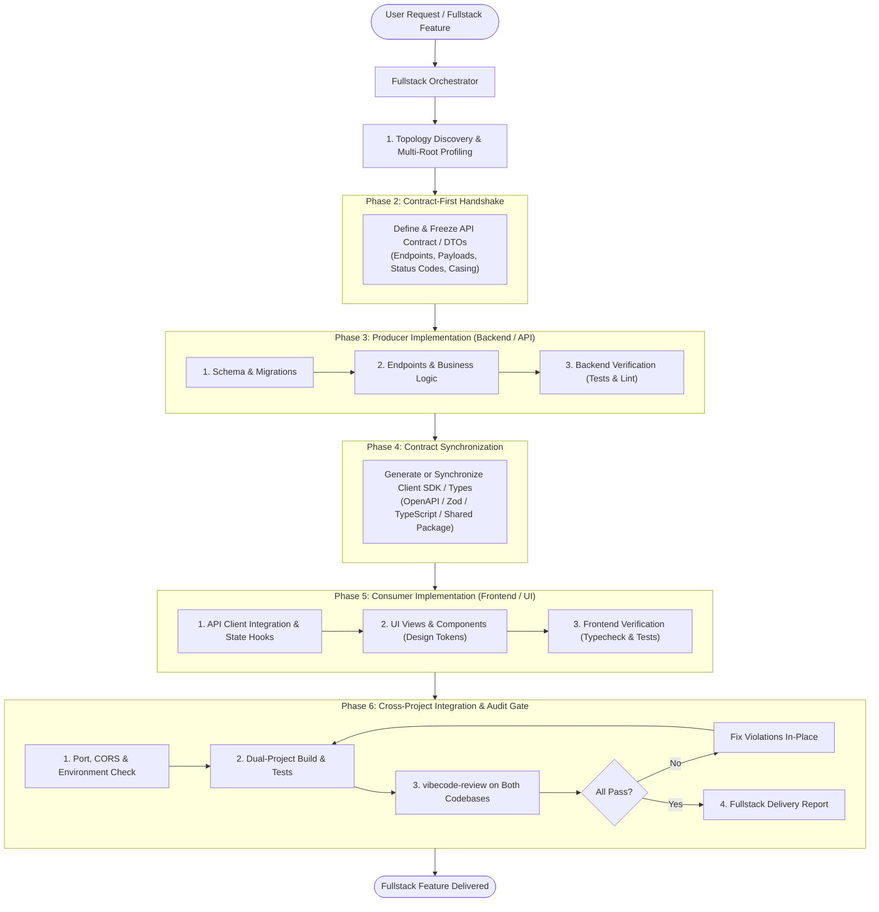

# Vibecode Fullstacks

## Overview

Execute complex, cross-project engineering tasks as a **unified Fullstack Developer**.

When features cross architectural boundaries—such as a frontend client (`web/`, `apps/client/`, `mobile/`) talking to a backend server (`api/`, `apps/server/`, `services/`), or multiple packages in a monorepo—single-project agents fail. They create mismatched data shapes, drift from API contracts, mix up build environments, or test only one side and declare victory while the other side is broken.

`vibecode-fullstacks` bridges cross-project boundaries through five structural pillars:
1. **Topology Discovery & Multi-Root Profiling**: Auto-detects project layouts (Monorepo, Polyrepo/Sibling directories, Microservices, or Meta-frameworks) and profiles each project's stack, rules, and commands independently.
2. **Contract-First Handshake**: Freezes API contracts, DTO schemas, and status codes *before* implementing business logic, establishing a single source of truth.
3. **Dependency-Ordered Execution**: Sequences implementation in natural fullstack order: Data & Migration $\to$ Backend Producer $\to$ Contract/SDK Sync $\to$ Frontend Consumer $\to$ Integration.
4. **Environment, Port & CORS Alignment**: Synchronizes `.env.example` templates, port bindings, CORS headers, and proxy configs so both sides integrate seamlessly.
5. **Dual-Project Verification Gate**: Executes type checks, unit tests, and `vibecode-review` across *both* projects, guaranteeing zero contract divergence and zero orphaned code.



---

## When to Use

- **Cross-Project Features**: Any task requiring changes in both a backend/API project and a frontend/client project.
- **Monorepos & Workspaces**: Projects structured with `apps/web` + `apps/api` + `packages/shared` (Turborepo, Nx, pnpm workspaces, Bun workspaces).
- **Polyrepos & Sibling Folders**: Workspaces containing separate client and server repositories (e.g. `../frontend` and `../backend`, or `client/` and `server/`).
- **Fullstack Meta-frameworks**: Next.js, Nuxt, Remix, SvelteKit where server actions, API routes, or database adapters integrate with frontend UI components.
- **API Versioning & Migration**: Updating an existing API endpoint and migrating all consumer clients without breaking backward compatibility.

### When to Skip
- **Single-project frontend-only**: Use `/use-vibecode` (or `/vibecode-workflow`).
- **Single-project backend-only**: Use `/use-vibecode` (or `/vibecode-workflow`).
- **Independent parallel modules within one repo**: Use `/vibecode-modules`.

---

## Topologies & Boundary Detection

Before touching any code, determine which topology describes the workspace:

| Topology | Directory Structure | Discovery Clues | Execution Strategy |
|---|---|---|---|
| **A: Monorepo** | `apps/web`, `apps/api`, `packages/contracts` | `pnpm-workspace.yaml`, `turbo.json`, `nx.json`, root `package.json` with `"workspaces"` | Run scoped commands (e.g. `pnpm --filter @app/api ...`). Shared contracts live in a local workspace package. |
| **B: Polyrepo / Sibling Folders** | `frontend/`, `backend/` or `../client`, `../server` | Separate `.git` folders, independent package manifests (`package.json`, `go.mod`, `Cargo.toml`, `requirements.txt`) | Switch directories (`cd <path>`) for project-specific commands. Contracts synced via shared schema files or copied types. |
| **C: Nested Microservices / BFF** | `gateway/`, `service-auth/`, `service-billing/`, `web/` | Multiple service directories with Dockerfiles or docker-compose | Identify Producer service, Gateway/BFF route, and Web consumer. Execute along the data flow chain. |
| **D: Unified Meta-Framework** | `app/api/`, `app/(routes)/`, `lib/db/` | Single `next.config.*`, `nuxt.config.*`, or `svelte.config.*` | Internal boundary: server-only code (`server-only`, route handlers, actions) vs client components (`'use client'`, UI). |

---

## The 5 Pillars of Cross-Project Fullstack Engineering

### 1. Topology Discovery & Multi-Root Profiling
Each project in the topology has its own tech stack, conventions, and constraints. Never assume rules from one project apply to the other:
- **Profile Each Project Root**:
  - Locate package manager, framework, language, and path aliases for Project A (e.g. TypeScript / Next.js) and Project B (e.g. Python / FastAPI or Go / Gin).
  - Check for project rules: Look for `.agents/project-rules.md`, `AGENTS.md`, or `CLAUDE.md` in **each project root**.
  - If a sub-project lacks project rules, run `vibecode-init` for that sub-project or inspect its existing patterns directly.
- **Identify Target Roles**:
  - **Producer (Provider)**: The service hosting the database, business logic, and API endpoints.
  - **Consumer (Client)**: The application consuming the API (web, mobile, CLI, BFF).

### 2. Contract-First Handshake
Never write speculative frontend code against an imagined backend, and never build backend endpoints without establishing the consumer contract:
- **Contract Specification**:
  - **HTTP Method & Path**: e.g. `POST /api/v1/workspaces/:id/members`
  - **Request Headers & Auth**: `Authorization: Bearer <token>`, `Content-Type: application/json`
  - **Request Payload DTO**: Exact JSON structure, required vs optional fields, validation constraints.
  - **Response Payload DTO**: Success envelope (e.g. `{ data: T }`) and error envelope (e.g. `{ error: { code: string, message: string } }`).
  - **Status Codes**: Expected HTTP 200/201, 400 (validation), 401/403 (auth), 404 (not found), 409 (conflict).
- **Type & Casing Alignment**:
  - Enforce explicit casing convention: if the backend uses `snake_case` (Python/Postgres) and the frontend uses `camelCase` (TypeScript), establish where serialization/transformation happens (serializer layer in backend or API client adapter in frontend).
  - Explicit nullability: distinguish between `null` (explicit absence) and `undefined` / omitted (optional).
  - Timestamp format: standardize on ISO 8601 strings (`2026-10-23T16:00:00Z`).

### 3. Dependency-Ordered Execution Order
Always implement fullstack features in strict sequence:

```
[1. Database & Schema] ──► [2. Backend Producer] ──► [3. Contract Sync] ──► [4. Frontend Consumer] ──► [5. Verification]
```

1. **Database & Schema**: Apply migrations, model definitions, seed scripts, or index updates in the producer project first.
2. **Backend Producer**: Implement service logic, repository queries, validation middleware, and controller routes in the backend project. Run backend unit/integration tests to confirm the endpoint works.
3. **Contract / SDK Sync**: Generate or update shared contracts, client SDKs, Zod schemas, or TypeScript interfaces. Never allow frontend code to write ad-hoc shapes.
4. **Frontend Consumer**: Update API client methods, state hooks, and UI components using the synchronized types. Implement loading, empty, and error states adhering to `vibecode/references/design.md`.
5. **Cross-Project Verification**: Run dual test suites, verify CORS and environment variables, and perform the integration audit.

### 4. Environment, Port & CORS Alignment
Fullstack features fail when environment configurations diverge:
- **Port Alignment**: Confirm backend port (e.g. `8080`) matches frontend proxy or environment variable (e.g. `NEXT_PUBLIC_API_URL=http://localhost:8080`).
- **CORS Configuration**: If consumer and producer run on different ports/domains, ensure backend CORS configuration includes the frontend development and production origins.
- **Credentials & Auth**: If using session cookies, configure `credentials: 'include'` on the frontend and `Access-Control-Allow-Credentials: true` on the backend.
- **Environment Templates**: Keep `.env.example` up to date in both projects whenever new environment variables are added.

### 5. Dual-Project Verification Gate
A task is never complete until both sides of the boundary pass all checks:
- **Backend Checks**: Migrations applied, unit/integration tests pass, linter passes, zero unhandled errors.
- **Frontend Checks**: Type check succeeds (`tsc --noEmit`), component tests pass, build succeeds.
- **Contract Parity**: Every property required by the frontend client is provided by the backend response; every property sent by the frontend is handled by the backend schema.
- **Audit Compliance**: Run `vibecode-review` across all modified files in both projects.

---

## Step-by-Step Procedure

### Stage 1: Topology Discovery & Scoping

1. **Scan the Workspace**:
   - Locate the root and subdirectories to identify projects:
     ```bash
     # Check for monorepo roots
     ls -la pnpm-workspace.yaml turbo.json nx.json package.json 2>/dev/null
     # Locate sub-projects
     find . -maxdepth 3 -name "package.json" -o -name "go.mod" -o -name "pyproject.toml" -o -name "Cargo.toml" -o -name "artisan"
     ```
2. **Profile Each Sub-Project**:
   - Identify: Project Name, Directory Path, Tech Stack, Package Manager, Test Command, Lint/Typecheck Command, Project Rules file (`.agents/project-rules.md`).
3. **Map the Data Flow**:
   - Producer Project: Directory path and framework (e.g. `backend/` - FastAPI).
   - Consumer Project: Directory path and framework (e.g. `frontend/` - Next.js).
   - Shared Layer: Directory path (e.g. `packages/contracts/` or shared schema files).

---

### Stage 2: Contract-First Handshake

Before writing implementation files, document and freeze the contract:

1. **Draft the Contract Handshake Table**:

| Endpoint | Method | Request DTO | Response DTO | Error Codes |
|---|---|---|---|---|
| `/api/v1/items` | `POST` | `CreateItemRequest` | `ItemResponse` (201) | `400 INVALID_INPUT`, `409 DUPLICATE` |
| `/api/v1/items/:id` | `GET` | None | `ItemResponse` (200) | `404 NOT_FOUND` |

2. **Define DTO Schemas**:
   - If a shared package exists (monorepo), write the TypeScript / Zod / OpenAPI schema directly in the shared package.
   - If polyrepo, define the schema in the producer project first, and write the corresponding types/client for the consumer project.

---

### Stage 3: Producer Implementation (Backend / API)

1. **Switch Context to Producer Directory**:
   - Always run commands relative to the producer project directory (e.g. `cd backend` or `pnpm --filter @app/api`).
2. **Database & Migrations**:
   - Create schema migration according to `vibecode/references/database.md`.
   - Never alter live databases manually; write repeatable migration scripts.
3. **Endpoint & Business Logic**:
   - Implement data layer queries, validation logic, and controller endpoints adhering to the relevant framework rules (`vibecode/frameworks/<stack>/rules.md`).
   - Validate input strictly at the boundary (reject invalid payloads with HTTP 400).
   - Return response matching the frozen Contract Handshake.
4. **Producer Verification**:
   - Run backend tests:
     ```bash
     # Example: Go / Python / Node
     go test ./... -v
     pytest tests/
     pnpm --filter api test
     ```
   - Ensure the new endpoints pass backend unit and integration tests.

---

### Stage 4: Contract Synchronization & Consumer Implementation

1. **Synchronize Contract / Client**:
   - If using code generation (`openapi-typescript`, `graphql-codegen`, `orval`), run the generation command.
   - If using shared packages, build the contract package (`pnpm --filter @repo/contracts build`).
   - If manual, write or update the typed API client methods and DTO interfaces in the consumer project.
2. **Switch Context to Consumer Directory**:
   - Operate inside the consumer project directory (e.g. `cd frontend` or `pnpm --filter @app/web`).
3. **API Client & State Hooks**:
   - Update API service functions to call the new endpoint.
   - Handle loading, success, error, and empty states.
4. **UI Implementation**:
   - Implement or update UI components adhering to `vibecode/references/design.md` and project design tokens.
   - Ensure responsive layout, semantic HTML, and accessibility attributes.
5. **Consumer Verification**:
   - Run frontend typecheck and tests:
     ```bash
     pnpm --filter web typecheck # or tsc --noEmit
     pnpm --filter web test
     ```

---

### Stage 5: Cross-Project Verification & Audit Gate

Execute the end-to-end audit across both project boundaries:

1. **Environment & Port Sanity Check**:
   - Check frontend API base URL matches backend server port.
   - Check CORS whitelist on backend allows frontend origin.
   - Verify both `.env.example` files have required keys documented.
2. **Contract Parity Checklist**:
   - [ ] Every request field sent by consumer is accepted by producer schema.
   - [ ] Every response field expected by consumer is returned by producer.
   - [ ] Error status codes (400, 401, 403, 404, 500) handled gracefully in UI.
   - [ ] Casing (camelCase vs snake_case) is consistent across the wire.
   - [ ] Dates and timestamps parse correctly without timezone shift.
3. **Dual Build & Test Suite**:
   - Run backend test suite $\to$ `[PASS]`
   - Run frontend test suite $\to$ `[PASS]`
   - Run frontend typecheck $\to$ `[PASS]`
4. **Compliance Review (`vibecode-review`)**:
   - Run `vibecode-review` covering all modified files in Producer, Consumer, and Shared directories.
   - Ensure zero remaining debug statements, zero leftover scratch files, and zero commented-out legacy code.
   - Confirm verdict is `[PASS]`.

---

## Command Execution & Path Context Protocol

> [!IMPORTANT]
> **Never run root commands blindly in a cross-project workspace.**
> Always target the specific project subdirectory or use workspace flags.

### Monorepo Command Protocol
```bash
# Turborepo / pnpm
pnpm --filter <producer-package> <command>
pnpm --filter <consumer-package> <command>

# Nx
nx test <producer-project>
nx test <consumer-project>

# npm / yarn
npm --prefix apps/api test
npm --prefix apps/web test
```

### Sibling / Polyrepo Command Protocol
```bash
# Execute inside sub-project directory
(cd backend && pytest)
(cd frontend && npm run build)

# Inspect git status across repositories
(cd backend && git status -s)
(cd frontend && git status -s)
```

---

## Sub-Agent Orchestration Patterns

When using sub-agents (via `vibecode-workflow` or platform tools), choose the execution pattern that fits the scope:

### Pattern A: Unified Fullstack Sub-Agent (Recommended for Standard Features)
- A single ephemeral sub-agent handles the full lifecycle across both projects.
- Ensures immediate context transfer from backend contract creation to frontend consumption.
- Eliminates handoff overhead while maintaining clean execution through the 5-phase pipeline.

### Pattern B: Sequenced Specialist Sub-Agents (For Large / Complex Epics)
- **Sub-Agent 1 (Producer)**: Implements database, endpoints, backend tests, and outputs the frozen contract.
- **Handoff Gate**: Main agent validates the backend tests and contract report.
- **Sub-Agent 2 (Consumer)**: In a fresh context, reads the contract report, synchronizes types, builds the UI, and runs frontend verification.
- **Main Agent**: Executes the cross-project integration check and final review gate.

---

## Fullstack Delivery Report Template

Upon completing a cross-project feature, produce this structured report:

```markdown
### 🌐 Fullstack Delivery Report: [Feature Name]

#### 1. Topology & Scope
- **Producer Project**: `[path]` ([Framework / Language])
- **Consumer Project**: `[path]` ([Framework / Language])
- **Shared Layer**: `[path or N/A]`

#### 2. Contract Handshake
- **Endpoints Touched**:
  - `[METHOD] [Path]`: `[Request DTO]` -> `[Response DTO]` (Status: `[200/201]`)
- **Schema & DTO Source**: `[File path to types/schema]`
- **Serialization / Casing**: `[e.g. camelCase across API | backend serializer]`

#### 3. Producer (Backend) Changes
- **Database / Migrations**: `[Migration files or N/A]`
- **Endpoints & Services**: `[List of files created/modified]`
- **Producer Verification**: `[Test command]: [X tests passed, 0 failures]`

#### 4. Consumer (Frontend) Changes
- **Client & State**: `[API client / hook files]`
- **UI Components & Views**: `[Component files created/modified]`
- **Design Tokens Used**: `[Colors, spacing, typography from design system]`
- **Consumer Verification**: `[Typecheck / test command]: [PASSED]`

#### 5. Cross-Project Handshake & Environment
- **Port & URL Config**: `[e.g. Frontend proxy -> http://localhost:8080]`
- **CORS Whitelist**: `[Verified on backend]`
- **.env.example Updated**: `[Yes / No / Unchanged]`
- **Contract Parity**: `[Verified: zero type or payload mismatches]`

#### 6. Compliance Gate (vibecode-review)
- **Verdict**: `[PASS]`
- **Rules Verified**: `[All clean code, security, hygiene, and design token rules met]`
```

---

## Common Mistakes & Antipatterns

| Mistake | Consequence | Correct Fullstack Practice |
|---|---|---|
| **Speculative Frontend Mocking** | Frontend is built against mock data; when backend is built, types and shapes clash, requiring full UI rewrite. | Always freeze the contract first (Phase 2), implement backend (Phase 3), then build frontend (Phase 4). |
| **Silent API Field Drift** | Backend renames `user_id` $\to$ `id` or returns `{ data: user }` instead of `{ user }`; frontend breaks silently at runtime. | Synchronize types via shared schema / codegen; verify contract parity explicitly. |
| **Testing Only One Project** | Agent runs `npm test` on frontend, ignores backend tests, and delivers broken API code. | Run verification test suites in BOTH projects before marking complete. |
| **Blind Root Commands** | Running `npm test` in a monorepo root where packages require scoped filters or directory context. | Use `pnpm --filter`, `npm --prefix`, or explicit `(cd <dir> && ...)` commands. |
| **Hardcoded Localhost in Code** | Hardcoding `fetch('http://localhost:8000/api')` in frontend components. | Use environment variables (`NEXT_PUBLIC_API_URL`, `VITE_API_URL`) or dev server reverse proxies. |
| **CORS Forgetting** | New backend endpoint deployed without updating allowed origins/methods/headers for the frontend domain. | Verify CORS headers and credentials mode during Phase 5 environment check. |
| **Unsynced `.env.example`** | Adding an API key or DB URL in `.env` without updating `.env.example`. | Update `.env.example` across all affected project roots immediately. |

