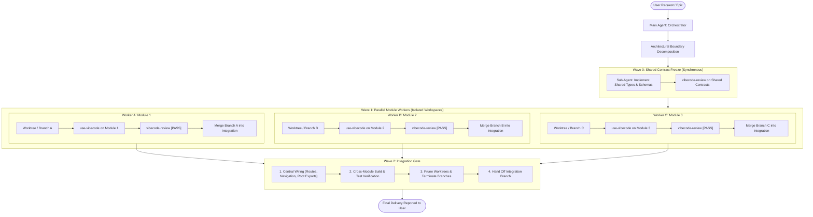
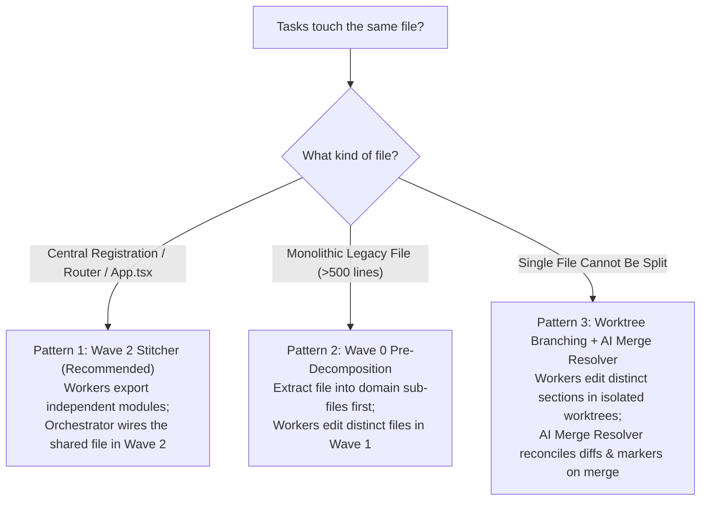

# Vibecode Modules

## Overview

Execute complex, multi-module engineering tasks in **parallel** with **zero merge conflicts**.

While `vibecode-workflow` executes tasks sequentially to prevent race conditions on shared files, `vibecode-modules` unlocks concurrent development across independent architectural modules, domains, packages, or components. It reduces total cycle time from $O(N)$ linear latency to $O(\text{waves})$ concurrent execution.

It prevents code collisions, dirty-tree clashes, lockfile divergence, and git index lockouts through five structural pillars:
1. **Wave 0 (Contract Freeze)**: Shared types, API contracts, DTOs, and schemas are defined and frozen first.
2. **Disjoint Boundary Partitioning**: Each parallel worker is strictly confined to a disjoint set of files and directories ($A \cap B = \emptyset$).
3. **Same-File Protocol**: When changes must touch the same file, applies structured patterns (Wave 2 Stitcher, Pre-Decomposition, or Worktree Section Branching).
4. **Workspace Isolation**: Each sub-agent operates in an isolated physical directory (Git worktrees for Claude Code/Cursor, or branch workspaces in Antigravity).
5. **Merge-on-Pass & Integration Gate**: Merges each branch as soon as its worker passes, resolves any textual or semantic conflicts using an AI Merge Resolver, then wires central registration and validates cross-module builds once the whole wave is merged.



---

## When to Use

- **Multi-Module / Full-Stack Features**: Features spanning independent frontend UI, backend API routes, and service layers that can run simultaneously once API contracts are set.
- **Monorepos & Micro-Frontends**: Independent changes across separate packages (e.g. `packages/auth`, `packages/billing`, `packages/components`).
- **Multiple Independent UI Screens or Widgets**: Adding 2 or more standalone components, dashboard cards, or settings tabs.
- **Batch Independent Refactors / Conversions**: Migrating multiple independent modules to TypeScript or updating tests across disparate directories.

### When to Skip (Use `/vibecode-workflow` instead)
- The task is small (< 3 files) or confined to a single directory.
- The changes have tight, interdependent step-by-step logic that cannot be decoupled.
- The repository has an entangled monolithic file structure where all logic resides in 1 or 2 central files.

---

## Roles and Responsibilities

### 1. Main Agent (Parallel Orchestrator)
- **Zero In-Depth Code Editing**: The Main Agent coordinates the pipeline, handles Git worktree creation/cleanup, merges branches, and monitors sub-agents.
- **Defines Boundary Contracts**: Identifies modules, determines the file globs for each worker, and enforces that file sets are completely disjoint.
- **Manages Concurrency**: Spawns workers in parallel waves, never more than [`maxConcurrentWorkers`](#concurrency-setting) at a time.
- **Executes the Integration Gate**: In Wave 2, resolves central wiring, runs the full test/typecheck suite, and cleans up worktrees.

### 2. Ephemeral Module Worker (Sub-Agent)
- **Runs in Workspace Isolation**: Operates exclusively inside its assigned Git worktree or branch workspace.
- **Respects Assigned Boundary**: Writes and edits code **only** within its designated file glob. Never modifies files outside its boundary or files created by Wave 0.
- **Runs the Full Vibecode Lifecycle**: Reads `use-vibecode/SKILL.md` first, executes implementation, and achieves a `[PASS]` verdict from `vibecode-review` inside its own worktree before reporting back.

---

## Concurrency Setting

`maxConcurrentWorkers` is the number of module workers that may run at the same time. Resolve it once in Stage 1, in this order:

1. **User request**: a number stated in the current request (e.g. "run 5 workers at a time").
2. **Config file**: the `maxConcurrentWorkers` field in `config.json`, in the same folder as this `SKILL.md`:
   ```json
   {
     "maxConcurrentWorkers": 3
   }
   ```
3. **Default**: `3`, when `config.json` is missing, unreadable, or has no `maxConcurrentWorkers` field.

The value must be a whole number of 1 or more; if it is not, use the default and tell the user. A value of `1` runs modules one at a time while keeping worktree isolation. When a wave has more modules than `maxConcurrentWorkers`, start the next queued module as soon as a running worker returns its `[PASS]` report and its branch is merged, so the new worktree branches from the updated integration branch. Skip any queued module whose dependencies are not merged yet.

---

## Same-File Protocol (Working with the Same File)

Can parallel workers edit the **same file**?
- **In the same working tree**: **NEVER.** Two agents running concurrently in the same working folder will clobber each other's edits and corrupt the git index.
- **In separate worktrees/branches**: **YES**, by following one of the three strategies below:



### Pattern 1: Wave 2 Central Stitcher (Recommended)
Use for registration files (`routes.ts`, `App.tsx`, `index.ts`, `di-container.ts`):
1. **Wave 1**: Parallel workers export their self-contained service, route, or component from their own folder without touching the central file.
2. **Wave 2**: The Orchestrator (or a single integration sub-agent) registers all exported modules into the shared file in one single, clean edit.

### Pattern 2: Wave 0 Pre-Decomposition (Modularize First)
Use when a large, existing file has multiple responsibilities that need updating:
1. **Wave 0 (Contract Freeze)**: Refactor the monolithic file into separate domain sub-files (e.g. `user-auth.ts`, `user-billing.ts`, `user-profile.ts`).
2. **Wave 1**: Parallel workers each modify their own separate extracted sub-file with zero chance of conflict.

### Pattern 3: Worktree Branching + AI Merge Resolver
Use when two tasks **must** modify distinct functions or sections of the exact same file and it cannot be split:
1. **Wave 1**: Assign each worker an isolated worktree on a separate branch (`agent/feature-a`, `agent/feature-b`). Ensure each worker knows which function/section it is assigned to touch.
2. **Merge-on-Pass**: When merging `agent/feature-b` into the integration branch after its worker passes:
   - If Git 3-way auto-merges cleanly $\to$ run build & tests.
   - If Git halts with a merge conflict $\to$ spawn an **AI Merge Resolver** sub-agent to reconcile conflict markers (`<<<<<<< HEAD`), preserve both features, unify imports, and verify with tests.

---

## Step-by-Step Procedure

### Stage 1: Fast Scoping & Dependency Partitioning

1. Analyze the user's request and map out target modules and file boundaries.
2. List each module's dependencies (the other modules whose code it imports or calls) and state them in the plan. A module with no dependencies is ready to start; the rest wait in the queue until every module they depend on is merged. If two modules depend on each other, combine them into one module or move the shared part into Wave 0.
3. Check if shared contracts (types, schemas, database models) or shared dependencies (npm packages) are required:
   - If **yes**: Schedule **Wave 0 (Contract Freeze)**.
   - If **no** (modules are completely self-contained): Proceed directly to **Wave 1**.
4. Resolve `maxConcurrentWorkers` (see [Concurrency Setting](#concurrency-setting)) and state the value in the plan.
5. Record the current branch as `<start-branch>`, then create an integration branch from it to host the unified changes. Name it after the request (e.g. `feat/user-billing`):
   ```bash
   git branch --show-current   # <start-branch>
   git checkout -b feat/<epic-name>
   ```
   If `feat/<epic-name>` already exists, ask the user whether to reuse it or choose another name.

---

### Stage 2: Wave 0 – Contract Freeze (If Applicable)

1. Dispatch a single worker to implement the shared types, interfaces, and schemas (e.g., `src/types/api.ts` or `src/shared/schema.ts`).
2. If new third-party packages are needed, install them now and commit lockfiles.
3. Verify contracts with `tsc` or linter, and commit to `feat/<epic-name>`.
4. **Freeze Contract**: Once committed, these files become strictly read-only for Wave 1 workers.

---

### Stage 3: Wave 1 – Parallel Module Execution

For each module whose dependencies are all merged (up to `maxConcurrentWorkers` at a time):

#### 1. Setup Isolated Workspace

- **For Claude Code / Cursor / CLI (Git Worktrees)**:
  ```bash
  git worktree add .worktrees/<module-name> -b agent/<module-name> feat/<epic-name>
  ```
- **For Google Antigravity**:
  Invoke sub-agent with `Workspace: 'branch'`.

#### 2. Dispatch Sub-Agent with Disjoint Brief

Use the [Parallel Module Worker Brief Template](#parallel-module-worker-brief-template).

#### 3. Parallel Execution & Monitoring
- Sub-agents run concurrently in their separate file paths.
- Each sub-agent executes `use-vibecode`, writes code only within its scope, runs `vibecode-review`, and returns its `[PASS]` report.

#### 4. Merge on Pass & Conflict Handling
As soon as a worker returns `[PASS]`, merge its branch in the main workspace on `feat/<epic-name>`. Do not wait for the rest of the wave. When several workers pass together, merge them one at a time.
```bash
if ! git merge agent/<module-name> --no-edit; then
  echo "Merge conflict detected on agent/<module-name>! Dispatching AI Merge Resolver..."
  # Invoke AI Merge Resolver sub-agent to reconcile conflict markers
fi
```

If a merge conflict occurs on shared files:
1. **Detect Conflict Markers**: Run `git status` to see conflicting files (`UU <filename>`).
2. **Dispatch AI Merge Resolver**: Spawn a sub-agent with the [AI Merge Resolver Brief Template](#ai-merge-resolver-brief-template).
3. **Resolve & Commit**: The sub-agent inspects `<<<<<<< HEAD`, `=======`, `>>>>>>>` markers, combines both workers' edits without dropping logic, fixes duplicate imports, runs typecheck (`tsc --noEmit`), and stages the resolved file (`git add <file> && git commit --no-edit`).

Once the merge is committed, start the next queued module whose dependencies are all merged (see [Concurrency Setting](#concurrency-setting)).

---

### Stage 4: Wave 2 – Integration Gate

Once all Wave 1 workers have passed and their branches are merged:

#### 1. Central Wiring & Hookup
If central registration is required (Pattern 1: Wave 2 Stitcher):
- Register new routes, component mounts, navigation links, or barrel exports in the central entrypoint.

#### 2. Holistic Verification Gate
Run the project's aggregate verification commands:
```bash
# Typecheck, test, and build
npm run test
npm run build # or tsc --noEmit
```
Confirm all integrated modules function seamlessly together.

#### 3. Worktree Cleanup & Termination
Safely remove all ephemeral worktrees and delete local agent branches:
```bash
# Clean worktrees
git worktree remove .worktrees/<module-name> --force
git worktree prune

# Delete temporary branches
git branch -D agent/<module-name>
```
Terminate idle sub-agents via platform tools (`manage_subagents` in Antigravity).

#### 4. Hand Off Integration Branch
Report `feat/<epic-name>` and its verification results to the user, then ask whether to merge it into `<start-branch>`, open a pull request, or keep it as is. Do not merge, push, or delete `feat/<epic-name>` without the user's approval.

---

## Parallel Module Worker Brief Template

When dispatching parallel workers, use this strict boundary brief:

```text
You are an ephemeral module worker running under the vibecode-modules lifecycle.
Assigned Module: <MODULE_NAME>
Allowed File Boundaries: <DISJOINT_FILE_GLOBS, e.g., src/features/auth/**>
Forbidden Files: ALL files outside your allowed boundaries. DO NOT edit shared contracts, routes.ts, or root configs.

=== MANDATORY FIRST ACTION ===
Before planning or writing code, you MUST:
1. Call read_file on `use-vibecode/SKILL.md`.
2. Confirm in your first message: "SKILL LOADED: use-vibecode (Module: <MODULE_NAME>)".

=== IMPLEMENTATION RULES ===
1. Only create or modify files inside your allowed directory boundary.
2. Code against the shared contracts already committed; do not modify shared contracts.
3. Follow all Vibecode rules: minimal in-place edits, no _v2 files, reuse design tokens.
4. Run tests for your module.

=== AUDIT GATE (Stage 3 - vibecode-review) ===
1. Re-read skill files from disk.
2. Run `git status` and `git diff` inside your worktree.
3. Fix every violation until `[PASS]`.

=== FINAL REPORT ===
Report Status: [PASS], changed files, verification results, and review checklist, then terminate.
```

---

## AI Merge Resolver Brief Template

When Git reports a merge conflict on a shared file while merging a passed branch, dispatch an AI Merge Resolver sub-agent using this brief:

```text
You are an AI Merge Resolver running under the vibecode-modules lifecycle.
Target Conflicted Files: <LIST_OF_CONFLICTED_FILES>
Incoming Branch: <INCOMING_BRANCH>
Base Branch: <BASE_BRANCH>

=== MANDATORY RESOLUTION PROTOCOL ===
1. READ CONFLICTED FILES:
   - Call read_file on each conflicted file.
   - Locate every `<<<<<<< HEAD`, `=======`, and `>>>>>>>` marker.

2. UNDERSTAND BOTH INTENTS:
   - Examine what HEAD introduced (existing changes on integration branch).
   - Examine what incoming branch introduced.
   - Under Vibecode rules, NEVER drop either worker's working code or features.
   - Unify both changes cleanly in-place.
   - Deduplicate shared imports and ensure consistent naming.
   - Remove ALL conflict markers completely.

3. VERIFY RESOLUTION:
   - Run typecheck (e.g. `npx tsc --noEmit`) to verify zero semantic or typing errors.
   - Run project tests.
   - Run `git diff` to ensure the resolution is clean and minimal.

4. COMMIT RESOLUTION:
   - Run `git add <conflicted-files>`
   - Run `git commit -m "chore(merge): resolve conflicts between <BASE_BRANCH> and <INCOMING_BRANCH>"`

5. REPORT:
   - Report Status: [RESOLVED]
   - Summary of how conflicts were unified.
   - Verification test results.
```

---

## Common Mistakes

| Mistake | Correction |
|---|---|
| Running multiple sub-agents in the same working directory | Always allocate isolated Git worktrees (`git worktree add`) or branch workspaces (`Workspace: 'branch'`) |
| Allowing parallel workers to edit shared routers or `App.tsx` | Central registration files belong strictly to Wave 2 (Integration Gate) |
| Parallel workers modifying `package.json` concurrently | Install dependencies once during Wave 0 (Contract Freeze) |
| Forgetting to add `.worktrees/` to `.gitignore` | Ensure `.worktrees/` is ignored so temporary directories never contaminate git tracking |
| Forgetting to remove worktrees after completion | Always run `git worktree remove --force` and `git worktree prune` in Wave 2 |
| Exceeding API token limits | Cap concurrent workers at `maxConcurrentWorkers` (default 3); queue additional modules until a worker finishes |
| Leaving passed branches unmerged until the whole wave finishes | Merge each `agent/<module-name>` branch as soon as its worker returns `[PASS]` |
| Starting a module before the modules it depends on are merged | Keep it queued until every dependency is merged, then branch its worktree from the updated integration branch |

