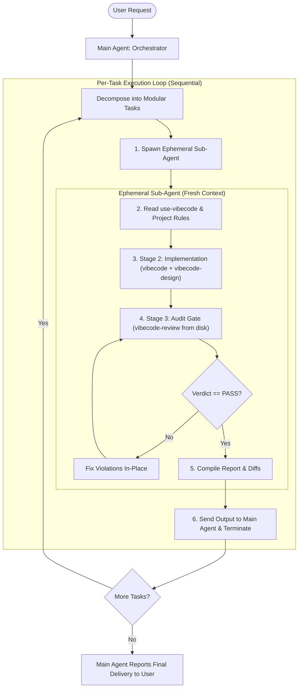

# Vibecode Workflow

## Overview

Execute complex or multi-step engineering tasks using an **ephemeral worker architecture**. Instead of running an entire project in a single, decaying conversation thread where skills and rules get forgotten over time, the **Orchestrator (Main Agent)** breaks the project down into discrete tasks and delegates each to an isolated **Sub-Agent**.

Every sub-agent begins with a clean context, immediately reads and activates `use-vibecode`, implements the task, runs the mandatory `vibecode-review` gate, reports its results back to the main agent, and terminates.



---

## Why Use This Workflow?

In multi-turn conversations, agents suffer from **context dilution and recency decay**:
- **Problem**: When a skill is loaded on turn 1, its instructions get pushed thousands of tokens back as tool logs, file edits, and chat messages accumulate. By turns 3–5, the model frequently forgets constraints, skips review gates, or introduces sloppy code.
- **Solution**: Sub-agents run in fresh, isolated contexts. Spawning a sub-agent per task ensures that `use-vibecode` is loaded at the top of its attention window. When the task finishes with a passing review, the sub-agent terminates, keeping the main agent's context clean and lightweight.

## When to skip this workflow

When the user's request names one existing file to change and needs no new file, run no sub-agent and no progress dashboard. Make the edit directly under `use-vibecode` and finish with the short review in `vibecode-review`, e.g. "fix the typo in the README heading". When the request does not name the file, dispatch a sub-agent as below.

---

## Roles and Responsibilities

### 1. Main Agent (Orchestrator)
- **Analyzes User Intent**: Interprets the user's high-level request, determines the scope, and splits work into modular tasks if needed.
- **NEVER Reads Source Code or Investigates Bugs**: **Strictly forbidden from reading project source code, implementation files, or grepping the codebase.** Code exploration, debugging, locating files, and root cause analysis belong entirely inside the Sub-Agent.
- **Maintains Live Progress Dashboard**: Creates and updates a rendered markdown artifact (`task-progress.md`) in the IDE's artifact panel so the user can observe live task milestones, touched files, and audit gates without conversation noise.
- **Dispatches Immediately**: As soon as the task is understood from the user's prompt, dispatches a sub-agent with the brief. Do NOT investigate first.
- **Does Not Write Code Directly**: Refrains from making file edits directly. All implementation happens inside sub-agents.
- **Validates Deliverables & Terminates Workers**: Reviews the sub-agent's output report, verifies the `[PASS]` review verdict, explicitly terminates the completed sub-agent (via `manage_subagents`), and handles the transition to the next task.

### 2. Ephemeral Sub-Agent (Worker)
- **Starts Fresh**: Operates with a clean slate, free of unrelated conversation baggage.
- **Reads Skills First**: Reads `use-vibecode/SKILL.md` and referenced framework rules before taking any action.
- **Performs All Code Exploration & Investigation**:
  - Locates relevant source files, searches the codebase, and determines the root cause.
  - Follows Vibecode Stage 1 (Preparation) to inspect existing patterns, utilities, and design tokens.
- **Follows Vibecode Lifecycle**:
  - **Stage 1 (Preparation & Discovery)**: Investigates code, locates target files, discovers existing utilities and design tokens.
  - **Stage 2 (Implementation)**: Writes minimal, in-place edits adhering to `vibecode` (and `vibecode-design` if UI is touched).
  - **Stage 3 (Verification Gate)**: Re-reads skills from disk, runs `vibecode-review`, and fixes all violations until a `[PASS]` verdict is achieved.
- **Reports and Exits**: Transmits the structured final report back to the main agent and ends execution immediately.

---

## Step-by-Step Procedure

### Stage 1: Fast Scoping & Immediate Dispatch (Main Agent)

> [!IMPORTANT]
> **Zero code investigation in the Main Agent.**
> When a user requests a feature, bug fix, or refactor:
> - **DO NOT** read source/implementation files.
> - **DO NOT** grep or search the codebase for symbols, styles, or logic.
> - **DO** write the task brief from the user's description and dispatch the sub-agent immediately. The sub-agent has a clean context specifically meant to absorb code exploration.

1. Read the user request. When it names one existing file to change and needs no new file, follow "When to skip this workflow".
2. If multi-part, split into sequential tasks. If single task, formulate the task description immediately.
3. Spawn the sub-agent using the [Sub-Agent Brief Template](#sub-agent-brief-template).

---

### Stage 2: Sub-Agent Dispatch (Main Agent)

Spawn a sub-agent using the platform's sub-agent tool (`invoke_subagent` in Antigravity, `Agent` in Claude Code):

#### Sub-Agent Brief Template

When dispatching, use this standard brief:

```text
You are an ephemeral task worker running under the vibecode-workflow lifecycle.
Task: <EXPLICIT_DESCRIPTION_OF_THE_TASK>

=== MANDATORY FIRST ACTION (DO NOT SKIP OR DELAY) ===
Before any planning, searching, or writing code, you MUST:

1. Call the read_file tool on `use-vibecode/SKILL.md` (full absolute path if needed).
2. Also read any matching framework skills that apply (TypeScript, Angular, CSS, etc.).
3. Confirm in your first response: "SKILL LOADED: use-vibecode + [other skills]"

Only after the skill content is actually in context may you proceed.

=== REST OF PROTOCOL ===
2. IMPLEMENT (Vibecode Stage 2):
   - Search for existing functions/types before adding new ones.
   - Edit existing code in place. Leave zero dead code, `_old`, or `V2` remnants.
   - If UI or styles are touched, apply `vibecode-design` tokens and viewport rules.

3. AUDIT GATE (Stage 3 – vibecode-review):
   - Re-read the skill files from disk again.
   - Run `git status` and `git diff`.
   - Fix every [FAIL] or [SKIPPED] item in-place.

4. REPORT & TERMINATE – output ONLY this format, then stop:
   - Status: [PASS]
   - Summary of Changes: <brief bullet points>
   - Files Modified/Created: <list of file paths>
   - Tests/Verification: <commands run and results>
   - Vibecode Review Verdict: <paste the review checklist>
```

---

### Stage 3: Sub-Agent Execution

The sub-agent executes independently:
1. **Reads Skills**: Calls file reading tools on `use-vibecode/SKILL.md`, `vibecode/SKILL.md`, `references/*`, and any project rules (`AGENTS.md`, `CLAUDE.md`).
2. **Implements**: Performs edits, checks build, runs tests.
3. **Audits**: Re-reads skills from disk, conducts the compliance check, and resolves any deficiencies.
4. **Sends Report**: Replies to the main agent with the delivery report and exits.

---

### Stage 4: Orchestrator Verification & Handoff (Main Agent)

Upon receiving the message from the sub-agent:
1. **Verify Verdict**: Ensure the sub-agent included a `[PASS]` verdict from `vibecode-review`. If violations remain unfixed, message the sub-agent or spawn a remediation task.
2. **Terminate Sub-Agent Immediately**: In Antigravity/agent environments, sub-agents cannot destroy their own session and stay in an `idle` state. The Main Agent must immediately terminate the sub-agent (e.g. `manage_subagents(Action: 'kill', ConversationIds: [subagent_id])`) so it does not linger or accept stray inputs.
3. **Update Progress**: Mark the completed task off the overall task list.
4. **Next Task**: If tasks remain, spawn the next sub-agent for the subsequent task.
5. **Final Delivery**: When all tasks are complete, summarize the full delivery for the user with file references and instructions to test.

---

## Agent-Specific Invocation Guide

### In Antigravity
The Main Agent invokes the sub-agent using `invoke_subagent`:
```json
{
  "Subagents": [
    {
      "TypeName": "self",
      "Role": "Vibecode Task Worker",
      "Prompt": "<Sub-Agent Brief Template with task details>"
    }
  ]
}
```
*Note: The main agent does not need to poll. Antigravity notifies the main agent automatically when the sub-agent sends its message.*

### In Claude Code
The Main Agent uses the `Agent` tool:
- Sets the prompt containing the task description and the mandatory `use-vibecode` protocol.
- Waits for the subagent run to conclude, receives output, and reviews diffs.

---

## Common Mistakes

| Mistake | Correction |
|---|---|
| Main agent investigating code before dispatching (reading source files, grepping codebase) | **Main agent must NOT analyze code.** Immediately dispatch the task to a sub-agent so code exploration happens in the fresh context. |
| Main agent writes code directly while running `vibecode-workflow` | Main agent must delegate code edits to sub-agents to preserve a clean orchestrator context |
| Spawning sub-agent without explicitly instructing it to read `use-vibecode` | Always use the standard brief template requiring `use-vibecode` as step 1 |
| Sub-agent finishes without running `vibecode-review` | The sub-agent must run the full compliance audit gate and achieve `[PASS]` before exiting |
| Running multiple sub-agents in parallel on the same files | Run sub-agents sequentially to avoid race conditions and merge conflicts |
| Sub-agent stays alive waiting for new instructions | Sub-agents in this workflow are ephemeral: the Main Agent must explicitly terminate/kill the sub-agent (`manage_subagents`) once the `[PASS]` report is received |

