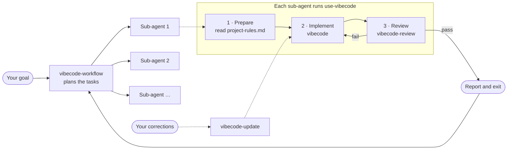

<p align="center">
  
</p>

<h1 align="center">Vibecode Skills</h1>

<p align="center">
  <b>Vibe code like you wrote it by hand</b><br>
  Agent skills for developers who want AI to write code the way they would: no over-engineering, readable and easy to maintain, clean, and written more carefully than usual. In any language, on any stack.
</p>

<p align="center">
  
  
  
  
  
  <a href="LICENSE"></a>
  <a href="CONTRIBUTING.md"></a>
</p>

<p align="center">
  <a href="#why-vibecode">Why</a> ·
  <a href="#works-with-any-stack">Any stack</a> ·
  <a href="#quick-start">Quick start</a> ·
  <a href="#showcase">Showcase</a> ·
  <a href="#features">Features</a> ·
  <a href="#skills">Skills</a> ·
  <a href="#how-it-works">How it works</a> ·
  <a href="#installation">Installation</a> ·
  <a href="CONTRIBUTING.md">Contributing</a>
</p>

---

## Why Vibecode

When you "vibe code" with an AI agent, the code usually goes wrong in one of two ways:

- **Sloppy shortcuts.** Duplicate functions, `_v2` files, commented-out old code, type or lint checks switched off to make errors go away, and colours picked by eye.
- **Over-engineering.** Layers of wrappers, factories and boilerplate that nobody asked for, so a person can no longer read the code quickly.

Vibecode aims for the middle: **code that reads as if a careful developer wrote it by hand.** You should be able to open any file, see what it does in a few seconds, and change it without fear, whether you or an agent wrote it.

The skills are plain Markdown. They work in **Claude Code**, **Google Antigravity** and **Cursor**, and they learn the rules of each project you use them in.

## Works with any stack

Vibecode is not tied to a language or framework. The rules come in three layers, and each one adds to the layer above it:

| Layer | Applies to | Where it lives |
| --- | --- | --- |
| **Core rules** | Every project, in any language | [`vibecode/SKILL.md`](.agents/skills/vibecode/SKILL.md) and [`references/`](.agents/skills/vibecode/references): change scope, naming, structure, cleanup, security, database, design |
| **Framework packs** | Only projects that use that technology | [`vibecode/frameworks/`](.agents/skills/vibecode/frameworks), loaded when a matching file is found at the project root |
| **Project rules** | One project | `.agents/project-rules.md`, written by `/vibecode-init` from your own folders, aliases, helpers and tools. It wins where it differs from a framework pack |

The framework packs available today:

| Area | Packs |
| --- | --- |
| Frontend | Angular, React, Next.js, Vue / Nuxt, CSS / SCSS / Sass / Less |
| Backend | Node.js (Express, Fastify, Hono), NestJS, Go, Python, Laravel |
| Runtimes and platforms | TypeScript, Bun, Firebase |

**No pack for your stack?** Vibecode still works. The agent applies the core rules and your project rules, and `/vibecode-init` records your project's conventions. Packs are only added once a rule for that technology has come up in real work, so when you correct the agent with `/vibecode-update`, a technology-only rule goes into a pack for it.

## Quick start

### Requirements

- One or more of: [Claude Code](https://claude.com/claude-code), [Google Antigravity](https://antigravity.google), or [Cursor](https://cursor.com)
- `git`, and a shell that supports `ln -s` (macOS, Linux or WSL)

### 1. Install

The easiest way is to let your agent do it. Copy this prompt and paste it into **Claude Code**, **Antigravity** or **Cursor**:

```text
Install or update the Vibecode skills from https://github.com/lysari/vibecode-skills for me.

1. Check which of these agents I have, by checking whether the folder exists:
   Claude Code (~/.claude), Google Antigravity (~/.gemini), Cursor (~/.cursor).
2. Before installing anything, ask me two questions and wait for both answers:
   - Which of the agents you found should get the skills? Recommend only the agent running
     this prompt, and let me pick more.
   - Install globally (every project) or only into the current project?
   Then show me the exact folders you will install into:
   - Claude Code: global ~/.claude/skills/, project .claude/skills/
   - Google Antigravity: global ~/.gemini/config/skills/, project .agents/skills/
   - Cursor: global ~/.cursor/skills/, project .cursor/skills/
     (never ~/.cursor/skills-cursor/, which is reserved for Cursor)
3. If I chose global:
   - Clone the repository to ~/vibecode-skills. If that folder already exists, run `git pull`
     in it to pull latest changes.
   - For each agent I picked, create the global folder if needed and symlink every folder
     in ~/vibecode-skills/.agents/skills/ into it with `ln -s -f <folder in the repo> <skills folder>/`.
     (Symlinks update automatically whenever ~/vibecode-skills is pulled).
4. If I chose the current project:
   - Do not create symlinks and do not write anything outside the current project, except
     a temporary clone.
   - Clone the repository into a temporary folder made with `mktemp -d`.
   - For each agent I picked, create the project folder if needed.
   - For each skill folder in <temporary clone>/.agents/skills/:
     - If the skill does not exist in the project folder, copy it in with
       `cp -R <folder in the clone> <skills folder>/`.
     - If the skill already exists in the project folder, check the version
       (under `metadata.version` in `SKILL.md`) between the project skill and the clone:
       - If the version has changed, replace the project's skill folder with the new version from the clone.
       - If the version is unchanged, keep the existing skill.
   - Tailor the installed skills to this project:
     - Check the project root against the "Framework rules" table in <skills folder>/vibecode/SKILL.md.
     - In <skills folder>/vibecode/frameworks/, keep only the folders for technologies matched in
       the project and remove the rest. If nothing matches, remove them all: the core rules still apply.
     - In <skills folder>/vibecode/SKILL.md, trim the "Framework rules" table to list only the rows matching this project.
   - Delete the temporary clone when you are done.
5. Run `ls -l` on each skills folder you installed into, then tell me which skills are installed
   or updated for which agents (showing versions, whether each was newly installed, updated, or already
   up to date, whether linked or copied, and which frameworks were kept for this project).
6. Ask me whether to set up the current project for Vibecode now. If I say yes, read
   vibecode-init/SKILL.md from one of the skills folders you installed into and follow it
   for this project. If I say no, remind me to start a new session and run /vibecode-init
   in my project.
```

Prefer to do it yourself? On **Claude Code**, add this repository as a plugin marketplace and install the suite:

```text
/plugin marketplace add lysari/vibecode-skills
/plugin install vibecode-suite@vibecode-skills
```

On **any agent supported by the [skills CLI](https://skills.sh)**, install with one command:

```bash
npx skills add lysari/vibecode-skills
```

On **any of the three agents**, clone the repository and link the skills:

```bash
git clone https://github.com/lysari/vibecode-skills.git
cd vibecode-skills

for target in ~/.claude/skills ~/.gemini/config/skills ~/.cursor/skills; do
  mkdir -p "$target"
  for d in "$PWD"/.agents/skills/*/; do
    ln -s "${d%/}" "$target/"
  done
done
```

Running it again is safe: links that already exist print `File exists` and are left alone.

To remove the skills later, see [Uninstall](#uninstall).

### 2. Set up your project

Start a new session in your project, then run:

```text
/vibecode-init
```

It profiles the project, or asks for your language, framework and tools when the project is new, and writes `.agents/project-rules.md` and `AGENTS.md`. Skip this step if the install prompt already set up the project.

### 3. Describe your task

```text
/vibecode-workflow add a user authentication modal
```

The workflow plans the work, runs each task in a fresh sub-agent, writes the code, and reviews it before handing it back. If you skipped step 2, it runs `vibecode-init` the first time it runs in a repository.

That is the only command you need. The other skills give you finer control when you want it.

## Showcase

The agent was asked to add a role check to an existing login handler. The example is Python, but the rules behind it are the same in every language.

<table>
<tr>
<th width="50%">❌ Without Vibecode</th>
<th width="50%">✅ With Vibecode</th>
</tr>
<tr>
<td valign="top">

```python
# ==========================
# AUTH HANDLERS
# ==========================

# Old version, kept just in case
# def handle_login(request): ...

def handle_login_v2(request):
    user = auth_service.login(request.data)
    if user and user.role:  # type: ignore
        user.has_access = check_role(user.role)
    return user
```

</td>
<td valign="top">

```python
def handle_login(request: LoginRequest) -> AuthenticatedUser:
    user = auth_service.login(request.data)

    return replace(
        user,
        has_access=user.role in ALLOWED_ROLES,
    )
```

</td>
</tr>
<tr>
<td valign="top">A second handler, a banner, a commented-out copy, no types and a silenced checker. Callers of <code>handle_login</code> never get the check.</td>
<td valign="top">The existing handler is changed in place, with the project's own types and role list. Every caller gets the check.</td>
</tr>
</table>

The same habits show up in every language, and Vibecode blocks them all:

| Habit | TypeScript | Python | Go | Rust |
| --- | --- | --- | --- | --- |
| A parallel copy instead of an edit | `loginV2` | `login_v2` | `LoginV2` | `login_v2` |
| Silencing the checker | `@ts-ignore` | `# type: ignore` | `//nolint` | `#[allow(...)]` |
| Giving up on types | `any` | `Any` | `interface{}` | `Box<dyn Any>` |

**[See the full showcase →](SHOWCASE.md)** for UI tokens, long sessions, review reports and learned rules.

## Features

| | |
| --- | --- |
| ✂️ **Small, in-place changes** | The agent searches for existing code before writing new code, edits it where it lives, and deletes what it replaces. No `_new`, `V2` or commented-out copies. |
| 🌐 **Any language, any stack** | The core rules hold everywhere. Framework packs add rules only when your project uses that technology. |
| 🧭 **Fits your project** | `vibecode-init` reads your folders, aliases, helpers and test setup once, and writes them to `.agents/project-rules.md` so every agent follows them. |
| 🎨 **Real design values** | `vibecode` reuses your components and tokens, measures values from design references instead of guessing, and keeps the UI accessible. |
| 🧹 **Fresh context for every task** | `vibecode-workflow` splits a goal into tasks and gives each one a new sub-agent, so rules are not forgotten twenty turns into a long chat. |
| ✅ **Checked before it is "done"** | `vibecode-review` re-reads the rule files from disk, inspects the actual `git diff`, and marks every rule pass, fail, skipped or not applicable. |
| 🧠 **Learns your corrections** | Tell it once with `/vibecode-update`, and the correction becomes a checkable rule for every later session. |

## Skills

### Engineering lifecycle

| Skill | Command | What it does |
| --- | --- | --- |
| `vibecode-workflow` | `/vibecode-workflow <goal>` | Splits a goal into tasks and runs each in a new sub-agent that builds, reviews, reports and exits. |
| `vibecode-modules` | `/vibecode-modules <epic>` | Runs parallel sub-agents on separate parts of the codebase, each in its own Git worktree, then merges them through an integration check. |
| `use-vibecode` | `/use-vibecode <task>` | Runs one task in the current chat: prepare, implement, then review. |
| `vibecode-init` | `/vibecode-init` | Profiles a repository and writes `.agents/project-rules.md`, and sets up `AGENTS.md` to use the workflow. |
| `vibecode` | `/vibecode` | The coding and UI rules: search first, change in place, one name per concept, no fake fixes, reuse components and design tokens. Core rules for any language, plus [framework packs](#works-with-any-stack) loaded only when the project uses them. |
| `vibecode-review` | `/vibecode-review [skill]` | Re-reads the rules from disk, inspects the session's diff, and reports each rule as pass, fail, skipped or N/A. |

### Learning your rules

| Skill | Command | What it does |
| --- | --- | --- |
| `vibecode-update` | `/vibecode-update [rule]` | Turns a coding or UI correction into one checkable rule in `vibecode`, in the core rules or in the pack for that technology. With no rule, collects the corrections from this session. |

## How it works



1. **Prepare.** The sub-agent reads `.agents/project-rules.md` (running `vibecode-init` if it is missing), loads the framework packs that match the project, and looks for helpers it can reuse.
2. **Implement.** It writes the change with `vibecode`, and with its design rules for any UI.
3. **Review.** It runs `vibecode-review` on its own diff and fixes every failed rule before reporting.
4. **Exit.** It hands its diff and review to the orchestrator and ends, so the next task starts with a clean context.

### Ways to use it

| You want to… | Run | Review included? |
| --- | --- | --- |
| Build a feature with several steps | `/vibecode-workflow <goal>` | Yes, in every sub-agent |
| Build several independent parts at once | `/vibecode-modules <epic>` | Yes, plus an integration check |
| Do one task in this chat | `/use-vibecode <task>` | Yes, before it reports |
| Check code that is already written | `/vibecode-review` | It is the review |
| Keep a correction for next time | `/vibecode-update <rule>` | Tested with two dry-run agents |

Run `/vibecode-review` yourself when code was written outside the workflow, or before you open a pull request.

## Installation

### Claude Code plugin

The marketplace offers these plugins:

| Plugin | Skills |
| --- | --- |
| `vibecode-suite` | The full lifecycle: `vibecode`, `vibecode-workflow`, `vibecode-review`, `vibecode-init`, `vibecode-update`, `use-vibecode` |
| `vibecode` | `vibecode`, `use-vibecode`, `vibecode-review`, `vibecode-init`, `vibecode-update` |
| `vibecode-workflow` | `vibecode-workflow` |

```bash
claude plugin marketplace add lysari/vibecode-skills
claude plugin install vibecode-suite@vibecode-skills
```

### Skills CLI

Install every skill with the [skills CLI](https://skills.sh):

```bash
npx skills add lysari/vibecode-skills
```

### Linking the skills

| Agent | Global skills folder | Project skills folder |
| --- | --- | --- |
| Claude Code | `~/.claude/skills/` | `.claude/skills/` |
| Google Antigravity | `~/.gemini/config/skills/` | `.agents/skills/` |
| Cursor | `~/.cursor/skills/` | `.cursor/skills/` |

> [!CAUTION]
> For Cursor, link into `~/.cursor/skills/`, **never** `~/.cursor/skills-cursor/`. That folder is reserved for Cursor's own skills.

<details>
<summary><b>Link to one agent only</b></summary>

```bash
# Claude Code
mkdir -p ~/.claude/skills
for d in "$PWD"/.agents/skills/*/; do ln -s "${d%/}" ~/.claude/skills/; done

# Antigravity
mkdir -p ~/.gemini/config/skills
for d in "$PWD"/.agents/skills/*/; do ln -s "${d%/}" ~/.gemini/config/skills/; done

# Cursor
mkdir -p ~/.cursor/skills
for d in "$PWD"/.agents/skills/*/; do ln -s "${d%/}" ~/.cursor/skills/; done
```

</details>

<details>
<summary><b>Install into the current project only</b></summary>

Project installs copy the skills instead of linking them, so the project does not depend on a clone elsewhere on your machine. They also keep only the framework packs your project uses. Run this from your project root:

```bash
tmp=$(mktemp -d)
git clone --depth 1 https://github.com/lysari/vibecode-skills.git "$tmp"

# Claude Code: .claude/skills   Antigravity: .agents/skills   Cursor: .cursor/skills
target_dir=".claude/skills"
mkdir -p "$target_dir"
for d in "$tmp"/.agents/skills/*/; do
  skill=$(basename "$d")
  target="$target_dir/$skill"
  if [ ! -d "$target" ]; then
    cp -R "${d%/}" "$target_dir/"
  else
    old_ver=$(grep -m1 'version:' "$target/SKILL.md" 2>/dev/null || true)
    new_ver=$(grep -m1 'version:' "$d/SKILL.md" 2>/dev/null || true)
    if [ "$old_ver" != "$new_ver" ]; then
      rm -rf "$target"
      cp -R "${d%/}" "$target_dir/"
    fi
  fi
done

# Keep only the framework packs that match this project
fw="$target_dir/vibecode/frameworks"
has()  { for f in "$@"; do [ -e "$f" ] && return 0; done; return 1; }
dep()  { [ -f package.json ] && grep -q "\"$1\"" package.json; }
drop() { rm -rf "$fw/$1"; }
next="next.config.js next.config.mjs next.config.ts"

has angular.json || drop angular
has $next || drop nextjs
{ dep react && ! has $next; } || drop react
{ dep vue || has nuxt.config.js nuxt.config.mjs nuxt.config.ts; } || drop vue
has nest-cli.json || drop nestjs
{ dep express || dep fastify || dep hono; } || drop nodejs
has go.mod || drop golang
has pyproject.toml requirements.txt setup.py || drop python
has artisan || drop laravel
has bunfig.toml bun.lock bun.lockb || drop bun
has tsconfig.json || drop typescript
has firebase.json || drop firebase
[ -n "$(find . -path ./node_modules -prune -o \( -name '*.css' -o -name '*.scss' -o -name '*.sass' -o -name '*.less' \) -print -quit)" ] || drop css

rm -rf "$tmp"
```

Running it again checks each skill's version and updates only those whose version changed. If no pack matches, the `frameworks/` folder ends up empty and the core rules still apply.

</details>

<details>
<summary><b>Link a single skill</b></summary>

Replace `<skill-name>` with a folder name from `.agents/skills/`, such as `use-vibecode`:

```bash
ln -s "$PWD/.agents/skills/<skill-name>" ~/.claude/skills/<skill-name>
ln -s "$PWD/.agents/skills/<skill-name>" ~/.gemini/config/skills/<skill-name>
ln -s "$PWD/.agents/skills/<skill-name>" ~/.cursor/skills/<skill-name>
```

> [!IMPORTANT]
> The order is `ln -s <source in this repo> <link in the agent folder>`. Swapping them creates a circular link inside the repository.

</details>

<details>
<summary><b>Check the links</b></summary>

```bash
ls -l ~/.claude/skills ~/.gemini/config/skills ~/.cursor/skills
```

Each skill should show an arrow pointing into this repository.

</details>

<details>
<summary><b>Remove the links</b></summary>

From the root of this repository:

```bash
for target in ~/.claude/skills ~/.gemini/config/skills ~/.cursor/skills; do
  for d in "$PWD"/.agents/skills/*/; do
    rm -f "$target/$(basename "$d")"
  done
done
```

This removes only the links. The repository is left as it is. If you move or rename the repository, the links break: remove them, then link again from the new location.

</details>

### Uninstall

To let your agent remove the skills, copy this prompt and paste it into **Claude Code**, **Antigravity** or **Cursor**:

```text
Uninstall the Vibecode skills from https://github.com/lysari/vibecode-skills for me.

1. Get the list of Vibecode skill names from the folders in ~/vibecode-skills/.agents/skills/.
   If ~/vibecode-skills does not exist, clone the repository into a temporary folder made
   with `mktemp -d` and list the folders in <temporary clone>/.agents/skills/ instead.
2. Look for skills with those names in these folders, both global and in the current project:
   - Claude Code: global ~/.claude/skills/, project .claude/skills/
   - Google Antigravity: global ~/.gemini/config/skills/, project .agents/skills/
   - Cursor: global ~/.cursor/skills/, project .cursor/skills/
     (never touch ~/.cursor/skills-cursor/, which is reserved for Cursor)
   If the current project is the vibecode-skills repository itself, skip its project folders.
   For each skill you find, note whether it is a symlink or a copied folder.
3. Show me what you found, grouped by agent and folder, and ask me which to remove.
   Wait for my answer before removing anything.
4. Remove only what I picked:
   - For a symlink, remove the link itself with `rm <link>`. Never delete what it points to.
   - For a copied folder, delete it with `rm -R <folder>`.
   Do not remove any other file or folder, and leave the skills folders in place even if empty.
5. If you are Claude Code, check whether any plugin from the vibecode-skills marketplace is
   installed. If one is, ask me whether to uninstall it and remove the marketplace too.
6. If ~/vibecode-skills exists, ask me whether to delete it. Only delete it after every link
   into it has been removed. Delete the temporary clone, if you made one.
7. Do not change .agents/project-rules.md or AGENTS.md in any project. Tell me they were left
   in place so I can remove them myself if I want to.
8. Run `ls -l` on each skills folder you removed from, then tell me what was removed and what
   is left.
```

Prefer to do it yourself? On **Claude Code**, uninstall the plugin and remove the marketplace:

```text
/plugin uninstall vibecode-suite@vibecode-skills
/plugin marketplace remove vibecode-skills
```

If you linked the skills, follow [Remove the links](#linking-the-skills) above, then delete your clone of the repository. If you copied them into a project, delete the copied skill folders from that project's skills folder.

## Repository layout

| Path | What it holds |
| --- | --- |
| [`.agents/skills/vibecode`](.agents/skills/vibecode) | Core coding and UI rules for any language, with [`references/`](.agents/skills/vibecode/references) for each topic (design included) and [`frameworks/`](.agents/skills/vibecode/frameworks) for the optional framework packs |
| [`.agents/skills/vibecode-workflow`](.agents/skills/vibecode-workflow) · [`use-vibecode`](.agents/skills/use-vibecode) | The orchestrator and the three-stage task lifecycle |
| [`.agents/skills/vibecode-modules`](.agents/skills/vibecode-modules) | Parallel sub-agents in separate worktrees, with an integration check |
| [`.agents/skills/vibecode-init`](.agents/skills/vibecode-init) · [`vibecode-review`](.agents/skills/vibecode-review) | Project profiling and the compliance review |
| [`.agents/skills/vibecode-update`](.agents/skills/vibecode-update) | Turning corrections into rules |
| [`.claude-plugin/`](.claude-plugin) | Claude Code plugin and marketplace manifests |
| [`assets/`](assets) | Logo and README images |

## Contributing

New rules, framework packs and fixes are welcome, for any language. Start with [CONTRIBUTING.md](CONTRIBUTING.md), and run `/vibecode-review` on your change before opening a pull request. To report a security issue, see [SECURITY.md](SECURITY.md).

## License

Vibecode Skills is released under the [MIT License](LICENSE) © 2026 SARI.
