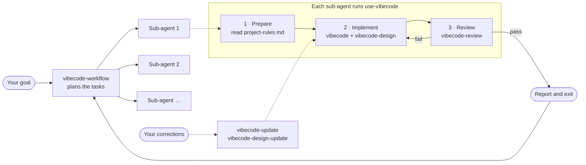

<p align="center">
  
</p>

<h1 align="center">Vibecode Skills</h1>

<p align="center">
  <b>Agent skills that make AI write code like a careful human would</b><br>
  Small in-place changes, real design tokens, and a review against your rules before anything is called done.
</p>

<p align="center">
  
  
  
  
  <a href="LICENSE"></a>
  <a href="CONTRIBUTING.md"></a>
</p>

<p align="center">
  <a href="#why-vibecode">Why</a> ·
  <a href="#quick-start">Quick start</a> ·
  <a href="#showcase">Showcase</a> ·
  <a href="#features">Features</a> ·
  <a href="#skills">Skills</a> ·
  <a href="#how-it-works">How it works</a> ·
  <a href="#installation">Installation</a> ·
  <a href="CONTRIBUTING.md">Contributing</a>
</p>

---

## Why Vibecode

When you "vibe code" with an AI agent, the code usually goes wrong in one of two ways:

- **Sloppy shortcuts.** Duplicate functions, `_v2` files, commented-out old code, `@ts-ignore` to make errors go away, and colours picked by eye.
- **Over-engineering.** Layers of wrappers, factories and boilerplate that nobody asked for, so a person can no longer read the code quickly.

Vibecode aims for the middle: **code that reads as if a careful developer wrote it by hand.** You should be able to open any file, see what it does in a few seconds, and change it without fear, whether you or an agent wrote it.

The skills are plain Markdown. They work in **Claude Code**, **Google Antigravity** and **Cursor**, and they learn the rules of each project you use them in.

## Quick start

### Requirements

- One or more of: [Claude Code](https://claude.com/claude-code), [Google Antigravity](https://antigravity.google), or [Cursor](https://cursor.com)
- `git`, and a shell that supports `ln -s` (macOS, Linux or WSL)

### 1. Install

The easiest way is to let your agent do it. Copy this prompt and paste it into **Claude Code**, **Antigravity** or **Cursor**:

```text
Install the Vibecode skills from https://github.com/lysari/vibecode-skills for me.

1. Clone the repository to ~/vibecode-skills. If that folder already exists, run `git pull` in it instead.
2. Check which of these agents I have, by checking whether the folder exists:
   Claude Code (~/.claude), Google Antigravity (~/.gemini), Cursor (~/.cursor).
3. Before linking anything, ask me two questions and wait for both answers:
   - Which of the agents you found should get the skills? Recommend only the agent running
     this prompt, and let me pick more.
   - Link globally (every project) or only into the current project?
   Then show me the exact folders you will link into:
   - Claude Code: global ~/.claude/skills/, project .claude/skills/
   - Google Antigravity: global ~/.gemini/config/skills/, project .agents/skills/
   - Cursor: global ~/.cursor/skills/, project .cursor/skills/
     (never ~/.cursor/skills-cursor/, which is reserved for Cursor)
   For each agent I picked, create the chosen folder if needed and symlink every folder
   in ~/vibecode-skills/.agent/skills/ into it with `ln -s <folder in the repo> <skills folder>/`.
   Skip links that already exist. Do not overwrite, move or delete any file.
4. Run `ls -l` on each skills folder you linked into, then tell me which skills are linked
   for which agents.
5. Ask me whether to set up the current project for Vibecode now. If I say yes, read
   ~/vibecode-skills/.agent/skills/vibecode-init/SKILL.md and follow it for this project.
   If I say no, remind me to start a new session and run /vibecode-init in my project.
```

Prefer to do it yourself? On **Claude Code**, add this repository as a plugin marketplace and install the suite:

```text
/plugin marketplace add lysari/vibecode-skills
/plugin install vibecode-suite@vibecode-skills
```

On **any of the three agents**, clone the repository and link the skills:

```bash
git clone https://github.com/lysari/vibecode-skills.git
cd vibecode-skills

for target in ~/.claude/skills ~/.gemini/config/skills ~/.cursor/skills; do
  mkdir -p "$target"
  for d in "$PWD"/.agent/skills/*/; do
    ln -s "${d%/}" "$target/"
  done
done
```

Running it again is safe: links that already exist print `File exists` and are left alone.

### 2. Set up your project

Start a new session in your project, then run:

```text
/vibecode-init
```

It profiles the project, or asks for your stack when the project is new, and writes `.agent/project-rules.md` and `AGENTS.md`. Skip this step if the install prompt already set up the project.

### 3. Describe your task

```text
/vibecode-workflow add a user authentication modal
```

The workflow plans the work, runs each task in a fresh sub-agent, writes the code, and reviews it before handing it back. If you skipped step 2, it runs `vibecode-init` the first time it runs in a repository.

That is the only command you need. The other skills give you finer control when you want it.

## Showcase

The agent was asked to add a role check to an existing login handler.

<table>
<tr>
<th width="50%">❌ Without Vibecode</th>
<th width="50%">✅ With Vibecode</th>
</tr>
<tr>
<td valign="top">

```ts
// ==========================
// AUTH HANDLERS
// ==========================

// Old version, kept just in case
// export async function handleLogin(req) { ... }

export async function handleLoginV2(req: any) {
  const user = await authService.login(req.body);
  // @ts-ignore role missing on type
  if (user && user.role) {
    return { ...user, hasAccess: checkRole(user.role) };
  }
  return user;
}
```

</td>
<td valign="top">

```ts
export async function handleLogin(
  req: LoginRequest,
): Promise<AuthenticatedUser> {
  const user = await authService.login(req.body);

  return {
    ...user,
    hasAccess: ALLOWED_ROLES.includes(user.role),
  };
}
```

</td>
</tr>
<tr>
<td valign="top">A second handler, a banner, a commented-out copy, <code>any</code> and <code>@ts-ignore</code>. Callers of <code>handleLogin</code> never get the check.</td>
<td valign="top">The existing handler is changed in place, with the project's own types and role list. Every caller gets the check.</td>
</tr>
</table>

**[See the full showcase →](SHOWCASE.md)** for UI tokens, long sessions, review reports and learned rules.

## Features

| | |
| --- | --- |
| ✂️ **Small, in-place changes** | The agent searches for existing code before writing new code, edits it where it lives, and deletes what it replaces. No `_new`, `V2` or commented-out copies. |
| 🧭 **Fits your project** | `vibecode-init` reads your folders, aliases, helpers and test setup once, and writes them to `.agent/project-rules.md` so every agent follows them. |
| 🎨 **Real design values** | `vibecode-design` reuses your components and tokens, measures values from design references instead of guessing, and keeps the UI accessible. |
| 🧹 **Fresh context for every task** | `vibecode-workflow` splits a goal into tasks and gives each one a new sub-agent, so rules are not forgotten twenty turns into a long chat. |
| ✅ **Checked before it is "done"** | `vibecode-review` re-reads the rule files from disk, inspects the actual `git diff`, and marks every rule pass, fail, skipped or not applicable. |
| 🧠 **Learns your corrections** | Tell it once with `/vibecode-update` or `/vibecode-design-update`, and the correction becomes a checkable rule for every later session. |

## Skills

### Engineering lifecycle

| Skill | Command | What it does |
| --- | --- | --- |
| `vibecode-workflow` | `/vibecode-workflow <goal>` | Splits a goal into tasks and runs each in a new sub-agent that builds, reviews, reports and exits. |
| `use-vibecode` | `/use-vibecode <task>` | Runs one task in the current chat: prepare, implement, then review. |
| `vibecode-init` | `/vibecode-init` | Profiles a repository and writes `.agent/project-rules.md`, and sets up `AGENTS.md` to use the workflow. |
| `vibecode` | `/vibecode` | The coding rules: search first, change in place, one name per concept, no fake fixes. Includes TypeScript, Angular, CSS and Firebase rules. |
| `vibecode-design` | `/vibecode-design` | The UI rules: reuse components and tokens, measure values from references, keep layouts consistent and accessible. |
| `vibecode-review` | `/vibecode-review [skill]` | Re-reads the rules from disk, inspects the session's diff, and reports each rule as pass, fail, skipped or N/A. |

### Learning your rules

| Skill | Command | What it does |
| --- | --- | --- |
| `vibecode-update` | `/vibecode-update [rule]` | Turns a coding correction into one checkable rule in `vibecode`. With no rule, collects the corrections from this session. |
| `vibecode-design-update` | `/vibecode-design-update [rule]` | Does the same for UI corrections, writing to `vibecode-design`. |

## How it works



1. **Prepare.** The sub-agent reads `.agent/project-rules.md` (running `vibecode-init` if it is missing) and looks for helpers it can reuse.
2. **Implement.** It writes the change with `vibecode`, and with `vibecode-design` for any UI.
3. **Review.** It runs `vibecode-review` on its own diff and fixes every failed rule before reporting.
4. **Exit.** It hands its diff and review to the orchestrator and ends, so the next task starts with a clean context.

### Ways to use it

| You want to… | Run | Review included? |
| --- | --- | --- |
| Build a feature with several steps | `/vibecode-workflow <goal>` | Yes, in every sub-agent |
| Do one task in this chat | `/use-vibecode <task>` | Yes, before it reports |
| Check code that is already written | `/vibecode-review` | It is the review |
| Keep a correction for next time | `/vibecode-update <rule>` | Tested with two dry-run agents |

Run `/vibecode-review` yourself when code was written outside the workflow, or before you open a pull request.

## Installation

### Claude Code plugin

The marketplace offers these plugins:

| Plugin | Skills |
| --- | --- |
| `vibecode-suite` | The full lifecycle: `vibecode`, `vibecode-workflow`, `vibecode-design`, `vibecode-review`, `vibecode-init`, `vibecode-update`, `vibecode-design-update`, `use-vibecode` |
| `vibecode` | `vibecode`, `use-vibecode`, `vibecode-review`, `vibecode-init` |
| `vibecode-workflow` | `vibecode-workflow` |
| `vibecode-design` | `vibecode-design`, `vibecode-design-update` |

```bash
claude plugin marketplace add lysari/vibecode-skills
claude plugin install vibecode-suite@vibecode-skills
```

### Linking the skills

| Agent | Global skills folder | Project skills folder |
| --- | --- | --- |
| Claude Code | `~/.claude/skills/` | `.claude/skills/` |
| Google Antigravity | `~/.gemini/config/skills/` | `.agents/skills/` |
| Cursor | `~/.cursor/skills/` | `.cursor/skills/` |

> [!CAUTION]
> For Cursor, link into `~/.cursor/skills/`, **never** `~/.cursor/skills-cursor/`. That folder is reserved for Cursor's own skills.

<details>
<summary><b>Link to one agent only</b></summary>

```bash
# Claude Code
mkdir -p ~/.claude/skills
for d in "$PWD"/.agent/skills/*/; do ln -s "${d%/}" ~/.claude/skills/; done

# Antigravity
mkdir -p ~/.gemini/config/skills
for d in "$PWD"/.agent/skills/*/; do ln -s "${d%/}" ~/.gemini/config/skills/; done

# Cursor
mkdir -p ~/.cursor/skills
for d in "$PWD"/.agent/skills/*/; do ln -s "${d%/}" ~/.cursor/skills/; done
```

</details>

<details>
<summary><b>Link a single skill</b></summary>

Replace `<skill-name>` with a folder name from `.agent/skills/`, such as `use-vibecode`:

```bash
ln -s "$PWD/.agent/skills/<skill-name>" ~/.claude/skills/<skill-name>
ln -s "$PWD/.agent/skills/<skill-name>" ~/.gemini/config/skills/<skill-name>
ln -s "$PWD/.agent/skills/<skill-name>" ~/.cursor/skills/<skill-name>
```

> [!IMPORTANT]
> The order is `ln -s <source in this repo> <link in the agent folder>`. Swapping them creates a circular link inside the repository.

</details>

<details>
<summary><b>Check the links</b></summary>

```bash
ls -l ~/.claude/skills ~/.gemini/config/skills ~/.cursor/skills
```

Each skill should show an arrow pointing into this repository.

</details>

<details>
<summary><b>Remove the links</b></summary>

From the root of this repository:

```bash
for target in ~/.claude/skills ~/.gemini/config/skills ~/.cursor/skills; do
  for d in "$PWD"/.agent/skills/*/; do
    rm -f "$target/$(basename "$d")"
  done
done
```

This removes only the links. The repository is left as it is. If you move or rename the repository, the links break: remove them, then link again from the new location.

</details>

## Repository layout

| Path | What it holds |
| --- | --- |
| [`.agent/skills/vibecode`](.agent/skills/vibecode) | Coding rules, with [`frameworks/`](.agent/skills/vibecode/frameworks) for each technology and [`references/`](.agent/skills/vibecode/references) for each topic |
| [`.agent/skills/vibecode-design`](.agent/skills/vibecode-design) | UI, token, layout and accessibility rules |
| [`.agent/skills/vibecode-workflow`](.agent/skills/vibecode-workflow) · [`use-vibecode`](.agent/skills/use-vibecode) | The orchestrator and the three-stage task lifecycle |
| [`.agent/skills/vibecode-init`](.agent/skills/vibecode-init) · [`vibecode-review`](.agent/skills/vibecode-review) | Project profiling and the compliance review |
| [`.agent/skills/vibecode-update`](.agent/skills/vibecode-update) · [`vibecode-design-update`](.agent/skills/vibecode-design-update) | Turning corrections into rules |
| [`.claude-plugin/`](.claude-plugin) | Claude Code plugin and marketplace manifests |
| [`assets/`](assets) | Logo and README images |

## Contributing

New rules, framework guides and fixes are welcome. Start with [CONTRIBUTING.md](CONTRIBUTING.md), and run `/vibecode-review` on your change before opening a pull request. To report a security issue, see [SECURITY.md](SECURITY.md).

## License

Vibecode Skills is released under the [MIT License](LICENSE) © 2026 SARI.
