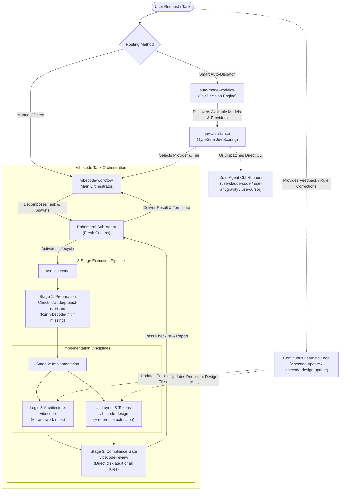

# 🧠 Agent Skills Suite (Vibecode Ecosystem)

> **"Transforming AI coding assistants from superficial 'vibe coders' into disciplined, architecture-first software engineers."**

A production-grade collection of modular agent skills engineered for **Claude Code**, **Google Antigravity**, and **Cursor**.

---

## 🎯 What Our Skills Mean & What They Aim To Do

### The Meaning Behind Our Skills
The phrase **"Vibe Coding"** has popularized writing software by raw AI intuition and superficial prompting. While fast at first, unconstrained vibe coding quickly degrades into fragile codebases:
- **Superficial fixes**: Patching symptoms with layers of helper wrappers rather than solving the root cause.
- **Code bloat & duplicates**: Adding `_v2`, `_new`, or parallel models because the agent didn't search the existing codebase.
- **UI by guesswork**: Eyeballing colors and margins instead of respecting existing design tokens, breaking consistency and accessibility.
- **Context rot**: Degradation over long chat sessions where rules are forgotten, assumptions slip in, and quality decays.

**Our skills suite exists to replace unconstrained "vibe coding" with disciplined engineering.** It equips your AI agents with the mental models, architectural respect, self-review discipline, and modular workflows of a seasoned principal engineer.

### What Our Skills Aim To Achieve

| Core Aim | What We Solve | How the Skills Enforce It | Key Skills |
|---|---|---|---|
| 🎯 **Minimal, Root-Cause Engineering** | Stop code bloat, wrapper sprawl, and fragile hacks | Solves problems in-place using existing project utilities with the smallest possible diff; never leaves dead code. | `vibecode`, `use-vibecode` |
| 🛡 **Zero Context Degradation** | Prevent agents from forgetting rules as conversations grow | Uses an ephemeral worker architecture where fresh sub-agents are spawned per task, audit their work, and terminate. | `vibecode-workflow` |
| 🎨 **Pixel-Faithful Design Token Fidelity** | Stop agents from guessing colors and margins by eye | Samples exact colors, spacing, and typography from reference assets into formal design tokens; enforces accessibility and responsive grids. | `vibecode-design` |
| 📋 **Enforced Pre-Completion Verification** | Stop agents from declaring "done" on broken or untested code | Enforces a mandatory post-implementation compliance review against disk-loaded rule files before returning to the user. | `vibecode-review` |
| 🧠 **Continuous Compounding Memory** | Stop agents from repeating the same mistakes across sessions | Turns every user correction or critique into a permanent, reusable checkable rule for future sessions with zero prompt crafting. | `vibecode-update`, `vibecode-design-update` |
| ⚖️ **Proportional Decision Intelligence** | Stop wasting heavy models on trivial tasks or under-powering architecture | Dynamically discovers active CLI models and routes tasks to the optimal provider and tier using TypeSafe's Jev model. | `auto-mode-workflow`, `jev-assistance` |
| 👥 **Dual-Agent Operator / Coder Separation** | Free human and operator agents from watching code stream | The operator agent designs, briefs, and tests, while a headless external CLI agent writes code asynchronously. | `use-claude-code`, `use-antigravity`, `use-cursor` |

---

## 📑 Table of Contents

- [What Our Skills Mean & What They Aim To Do](#-what-our-skills-mean--what-they-aim-to-do)
- [System Architecture](#-system-architecture)
- [Skills Catalog](#-skills-catalog)
  - [Vibecode Engineering Lifecycle](#1-vibecode-engineering-lifecycle)
  - [Continuous Learning & Rule Updates](#2-continuous-learning--rule-updates)
  - [Decision Intelligence & Task Routing](#3-decision-intelligence--task-routing)
  - [Dual-Agent CLI Runners](#4-dual-agent-cli-runners)
- [Core Workflows & Philosophies](#-core-workflows--philosophies)
  - [The Vibecode Philosophy: Real Engineering vs "Vibe Coding"](#the-vibecode-philosophy-real-engineering-vs-vibe-coding)
  - [Ephemeral Sub-Agent Architecture](#ephemeral-sub-agent-architecture)
  - [Decision Layer: TypeSafe Jev Model](#decision-layer-typesafe-jev-model)
- [Installation & Setup](#-installation--setup)
  - [Agent Skill Paths](#agent-skill-paths)
  - [Link All Skills (Recommended)](#link-all-skills-recommended)
  - [Link by Agent](#link-by-agent)
  - [Link a Single Skill](#link-a-single-skill)
  - [Verification](#verification)
  - [Unlinking](#unlinking)
- [Project Onboarding Quickstart](#-project-onboarding-quickstart)
- [Repository Structure](#-repository-structure)

---

## 🏛 System Architecture

The following diagram illustrates how the skills interact across orchestrators, ephemeral sub-agents, decision gates, and CLI runners:



---

## 📦 Skills Catalog

### 1. Vibecode Engineering Lifecycle

| Skill | Trigger / Command | Description |
|---|---|---|
| **`vibecode-workflow`** | `/vibecode-workflow` | **Multi-task Orchestrator.** Decomposes complex engineering goals into modular tasks executed by isolated, ephemeral sub-agents. Prevents context degradation and skill decay over long sessions. |
| **`use-vibecode`** | `/use-vibecode` | **End-to-End Task Runner.** Glues the complete 3-stage lifecycle together: Stage 1 (Preparation & Rule Discovery) → Stage 2 (Implementation) → Stage 3 (Mandatory `vibecode-review` compliance audit). |
| **`vibecode-init`** | `/vibecode-init` | **Repository Profiler & Onboarding.** Inspects directory architecture, path aliases, code conventions, and test setups to generate `.claude/project-rules.md` and configure root `AGENTS.md`, `CLAUDE.md`, and `GEMINI.md`. |
| **`vibecode`** | `/vibecode` | **Clean Code Standards.** Enforces surgical, minimal changes that address root causes without code bloat, wrapper sprawl, or naming duplication. Includes language- and framework-specific rules (TypeScript, Angular, CSS, Firebase). |
| **`vibecode-design`** | `/vibecode-design` | **Pixel-Faithful UI Engineering.** Extracts measured design tokens (colors, spacing, typography, radii, blur) from reference images and designs. Enforces layout consistency, keyboard navigation, and accessibility standards. |
| **`vibecode-review`** | `/vibecode-review` | **Mandatory Post-Implementation Compliance Gate.** Audits session diffs directly against disk-loaded skill files. Evaluates every applicable rule with a pass/fail checklist before work is declared complete. |

---

### 2. Continuous Learning & Rule Updates

| Skill | Trigger / Command | Description |
|---|---|---|
| **`vibecode-update`** | `/vibecode-update [rule]` | **Distills User Coding Corrections.** Translates user complaints, feedback, or coding conventions into permanent, stack-agnostic checkable rules inside `vibecode/SKILL.md` or framework rules. |
| **`vibecode-design-update`** | `/vibecode-design-update [rule]` | **Distills User UI Corrections.** Captures UI and styling corrections (spacing, tokens, contrast, layout behaviors) into persistent checkable rules inside `vibecode-design/SKILL.md`. |

---

### 3. Decision Intelligence & Task Routing

| Skill | Trigger / Command | Description |
|---|---|---|
| **`auto-mode-workflow`** | `/auto-mode-workflow` | **Adaptive Provider & Model Router.** Discovers active CLI tools and model tiers (lightweight vs. deep reasoning), profiles task complexity, and routes the work via Jev to the most proportional, cost-effective provider. |
| **`jev-assistance`** | `/jev-assistance` | **Probabilistic Decision Gate.** Uses TypeSafe's Jev model (`scripts/choose.mts`) to score options on fit, simplicity, and safety. Decides whether to auto-select the best option or present a typed ranking to the user. |

---

### 4. Dual-Agent CLI Runners

These skills split complex tasks between an **Operator** (who plans, builds, reviews, and tests) and a headless **Coder** process running in an external CLI.

| Skill | Trigger / Command | Target CLI | Key Modes |
|---|---|---|---|
| **`use-claude-code`** | `/use-claude-code` | `claude -p` | Direct session, sub-agent runner, remote SSH host (`--host`) |
| **`use-antigravity`** | `/use-antigravity` | `agy` | Headless accept-edits mode (`--mode accept-edits`), streaming JSON |
| **`use-cursor`** | `/use-cursor` | `agent` | Cursor Agent CLI (`agent -p --force --trust`) with streaming JSON |

---

## 💡 Core Workflows & Philosophies

### The Vibecode Philosophy: Real Engineering vs "Vibe Coding"

A superficial "vibe coder" patches bugs by adding more code—layering wrapper functions, duplicating types, swallowing errors, or slapping quick hacks on top of symptoms. Over time, the codebase becomes fragile, brittle, and impossible to reason about.

**Vibecode demands disciplined engineering:**
1. **Find Before Creating**: Search the repository for existing functions, constants, and utilities before introducing new ones.
2. **In-Place Surgery**: Modify existing files in place and clean up deprecated code immediately. Never leave `_v2`, `_new`, or commented-out remnants.
3. **Single Source of Truth**: Define each concept once. Never introduce translation layers that duplicate data under different names.
4. **Never Bypass Guards**: Never disable validations, authentication checks, or test assertions to make a change pass.
5. **Pixel Measurement over Intuition**: In UI design, measure colors, padding, and typography from real references rather than guessing by eye.

---

### Ephemeral Sub-Agent Architecture

Long-running agent conversations suffer from **context rot**: prompt context fills up, earlier instructions get diluted, and strict compliance rules are forgotten.

`vibecode-workflow` solves this with an ephemeral worker pattern:
1. The **Orchestrator (Main Agent)** maintains high-level awareness of the project plan.
2. Each sub-task is delegated to a **fresh, isolated Sub-Agent**.
3. The Sub-Agent loads `use-vibecode`, applies clean code and design guidelines, runs `vibecode-review`, and returns a structured completion report.
4. The Sub-Agent is **terminated immediately**, returning clean results without polluting parent context.

---

### Decision Layer: TypeSafe Jev Model

When multiple execution paths or scope decisions arise, `jev-assistance` steps in:
- Executes `scripts/choose.mts` against TypeSafe's System One (Jev) decision model.
- Analyzes candidate choices across simplicity, reversibility, and alignment.
- **Auto-executes** when the confidence margin is high and the operation is safe.
- **Surfaces a ranked recommendation** when high-stakes human approval is required.

---

## 🚀 Installation & Setup

Skills can be linked into your agent tools globally (available in every project) or locally (scoped to one repository).

### Agent Skill Paths

| Agent | Global Skills Directory | Project Skills Directory |
|---|---|---|
| **Claude Code** | `~/.claude/skills/` | `.claude/skills/` |
| **Google Antigravity** | `~/.gemini/config/skills/` | `.agents/skills/` |
| **Cursor** | `~/.cursor/skills/` | `.cursor/skills/` |

> [!CAUTION]
> For Cursor, link skills into `~/.cursor/skills/`. **Never** link into `~/.cursor/skills-cursor/`, which is reserved exclusively for Cursor's internal system skills.

---

### Link All Skills (Recommended)

Run this one-liner from the root of this repository to link all skills to Claude Code, Antigravity, and Cursor simultaneously:

```bash
for target in ~/.claude/skills ~/.gemini/config/skills ~/.cursor/skills; do
  mkdir -p "$target"
  for d in "$PWD"/.claude/skills/*/; do
    ln -s "${d%/}" "$target/"
  done
done
```

> [!NOTE]
> Re-running this command is completely safe. Existing symlinks will output `File exists` and will not be overwritten.

---

### Link by Agent

To link skills to a specific tool only:

```bash
# Claude Code
mkdir -p ~/.claude/skills
for d in "$PWD"/.claude/skills/*/; do ln -s "${d%/}" ~/.claude/skills/; done

# Antigravity
mkdir -p ~/.gemini/config/skills
for d in "$PWD"/.claude/skills/*/; do ln -s "${d%/}" ~/.gemini/config/skills/; done

# Cursor
mkdir -p ~/.cursor/skills
for d in "$PWD"/.claude/skills/*/; do ln -s "${d%/}" ~/.cursor/skills/; done
```

---

### Link a Single Skill

Replace `<skill-name>` with the directory name of the skill (e.g., `use-vibecode`):

```bash
# Claude Code
ln -s "$PWD/.claude/skills/<skill-name>" ~/.claude/skills/<skill-name>

# Antigravity
ln -s "$PWD/.claude/skills/<skill-name>" ~/.gemini/config/skills/<skill-name>

# Cursor
ln -s "$PWD/.claude/skills/<skill-name>" ~/.cursor/skills/<skill-name>
```

> [!IMPORTANT]
> The syntax order is `ln -s <source-in-this-repo> <target-link-in-agent-dir>`. Do not invert the arguments, or a circular symlink will be created inside the repository.

---

### Verification

Verify that your symlinks are active and pointing back to this repository:

```bash
# Verify Claude Code
ls -l ~/.claude/skills

# Verify Antigravity
ls -l ~/.gemini/config/skills

# Verify Cursor
ls -l ~/.cursor/skills
```

Each linked entry should show an arrow pointing to its absolute path inside this repository.

---

### Unlinking

To safely remove the symlinks from an agent (leaving this repository untouched):

```bash
# Remove all linked skills from all three agents
for target in ~/.claude/skills ~/.gemini/config/skills ~/.cursor/skills; do
  for d in "$PWD"/.claude/skills/*/; do
    rm -f "$target/$(basename "$d")"
  done
done
```

To remove a single linked skill:

```bash
rm ~/.claude/skills/<skill-name>
rm ~/.gemini/config/skills/<skill-name>
rm ~/.cursor/skills/<skill-name>
```

> [!NOTE]
> If you relocate or rename this repository, existing symlinks will break. Run the unlinking script, then re-run the linking script from the new repository directory.

---

## 🛠 Project Onboarding Quickstart

When onboarding a new or existing repository to the Vibecode ecosystem:

1. **Initialize the Project**:
   Open your agent in the target project and run:
   ```text
   /vibecode-init
   ```
   This performs an architectural scan and creates:
   - `.claude/project-rules.md`: Captures project structure, path aliases, test tooling, and local idioms.
   - `AGENTS.md`: Directs all AI agents to use `/vibecode-workflow` and abide by `.claude/project-rules.md`.
   - `CLAUDE.md` and `GEMINI.md`: Symlinks or pointers directly to `AGENTS.md` to guarantee cross-client consistency.

2. **Execute Tasks**:
   Start developing with:
   ```text
   /vibecode-workflow implement the user authentication modal using liquid design tokens
   ```

3. **Verify Compliance**:
   Before delivering work or merging, verify against the rules:
   ```text
   /vibecode-review
   ```

4. **Teach the Agent**:
   Whenever you correct the agent's code or UI style, save it permanently:
   ```text
   /vibecode-update always use named exports instead of default exports
   /vibecode-design-update always use 8px grid spacing for card headers
   ```

---

## 📁 Repository Structure

```text
skills/
├── .claude/
│   └── skills/
│       ├── auto-mode-workflow/     # Intelligent provider & model routing
│       │   ├── SKILL.md
│       │   └── config.json
│       ├── jev-assistance/         # Jev decision model integration
│       │   ├── SKILL.md
│       │   └── scripts/            # choose.mts, report.mts, cursor-session.mts
│       ├── use-antigravity/        # Operator/Coder separation for Antigravity (agy)
│       │   └── SKILL.md
│       ├── use-claude-code/        # Operator/Coder separation for Claude Code
│       │   └── SKILL.md
│       ├── use-cursor/             # Operator/Coder separation for Cursor agent
│       │   └── SKILL.md
│       ├── use-vibecode/           # End-to-end 3-stage Vibecode lifecycle
│       │   └── SKILL.md
│       ├── vibecode/               # Core coding hygiene & standards
│       │   ├── SKILL.md
│       │   ├── frameworks/         # Angular, CSS, Firebase, TypeScript rules
│       │   └── references/         # Cleanup, change-scope, naming, project-hygiene
│       ├── vibecode-design/        # UI, design tokens, layout & accessibility
│       │   └── SKILL.md
│       ├── vibecode-design-update/ # UI correction distillation
│       │   └── SKILL.md
│       ├── vibecode-init/          # Project profiling & onboarding rules
│       │   └── SKILL.md
│       ├── vibecode-review/        # Post-implementation disk compliance gate
│       │   └── SKILL.md
│       ├── vibecode-update/        # Code correction distillation
│       │   └── SKILL.md
│       └── vibecode-workflow/      # Ephemeral sub-agent multi-task orchestrator
│           └── SKILL.md
├── projects/
│   └── demo/                       # Reference implementation & testbed project
└── README.md                       # Repository documentation
```

---

## 📄 License

Internal developer tooling and agent skill library. Designed for rapid, reliable, and compliant AI-assisted software engineering.
