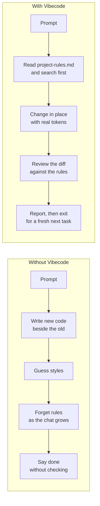

<p align="center">
  
</p>

<h1 align="center">Vibecode Showcase</h1>

<p align="center">
  <b>The same requests, with and without Vibecode</b><br>
  Five everyday tasks, what a plain agent tends to produce, and what changes with the skills.
</p>

<p align="center">
  <a href="#at-a-glance">At a glance</a> ·
  <a href="#1-changing-existing-code">Existing code</a> ·
  <a href="#2-building-a-ui-component">UI component</a> ·
  <a href="#3-a-long-multi-step-feature">Long session</a> ·
  <a href="#4-saying-done">Saying "done"</a> ·
  <a href="#5-correcting-the-agent">Corrections</a> ·
  <a href="README.md">Back to README</a>
</p>

---

The examples are short and simplified so they fit on one screen, but each one shows a habit we kept seeing in real sessions. The "with Vibecode" side follows the rules in [`.agent/skills/`](.agent/skills); the skill that enforces each one is named in the table.

## At a glance

| | Without Vibecode | With Vibecode | Skill |
| --- | --- | --- | --- |
| ✂️ **Changing code** | Adds `handleLoginV2` beside the old function and comments the old one out. | Edits the function in place and deletes what it replaces. | `vibecode` |
| 💬 **Comments** | Banners like `// ===== HANDLERS =====` and comments that repeat the code. | No banners. Comments only where a shared helper needs one. | `vibecode` |
| 🎨 **UI values** | `#0369a1`, `margin-top: 13px`, a clickable `div`. | The project's tokens and spacing scale, a real `button`, a label and a focus ring. | `vibecode-design` |
| 🧹 **Long sessions** | By turn 15 it has forgotten the turn 1 conventions and duplicates a client. | Each task gets a new sub-agent that reads the rules again. | `vibecode-workflow` |
| 🩹 **Errors** | `@ts-ignore`, an empty `catch`, or a disabled check to make it pass. | Fixes the cause. Never turns off a guard, type or test. | `vibecode` |
| ✅ **Saying "done"** | "Everything follows best practices!" without looking at the diff. | A rule-by-rule report built from the real `git diff`. | `vibecode-review` |
| 🧠 **Corrections** | You repeat the same correction every session. | The correction becomes a rule that later reviews check. | `vibecode-update` |
| ⚖️ **Cost** | The same large model for a typo and for a redesign. | The task is scored and sent to a model tier that fits. | `auto-mode-workflow` |



---

## 1. Changing existing code

> **Request:** "Only admins and editors should get access after login."

<table>
<tr>
<th width="50%">❌ Without Vibecode</th>
<th width="50%">✅ With Vibecode</th>
</tr>
<tr>
<td valign="top">

```ts
// ==========================================
// AUTH HANDLERS
// ==========================================

// Old implementation, kept just in case
// export async function handleLogin(req: Request) {
//   const user = await authService.login(req.body);
//   return user;
// }

// New implementation with roles
export async function handleLoginV2(req: any) {
  // Check if request exists
  if (!req || !req.body) {
    return null;
  }

  const user = await authService.login(req.body);

  // @ts-ignore role missing on user type
  if (user && user.role) {
    const hasAccess = checkUserRoleHelper(user.role);
    return { ...user, hasAccess };
  }

  return user;
}

function checkUserRoleHelper(role: any) {
  return role === 'admin' || role === 'editor';
}
```

</td>
<td valign="top">

```ts
export async function handleLogin(
  req: LoginRequest,
): Promise<AuthenticatedUser> {
  const user = await authService.login(req.body);

  return {
    ...user,
    hasAccess: ALLOWED_ROLES.includes(user.role),
  };
}
```

</td>
</tr>
</table>

| Without Vibecode | With Vibecode |
| --- | --- |
| A new `handleLoginV2`, so every existing caller of `handleLogin` still skips the check | `handleLogin` changed in place, so every caller gets the check |
| The old function left behind as a comment | The old code is gone; git keeps the history |
| `any` and `@ts-ignore` to hide a type error | The project's `LoginRequest` and `AuthenticatedUser` types |
| A one-off `checkUserRoleHelper` with the roles typed out | The existing `ALLOWED_ROLES` list, found by searching first |
| A banner and comments that repeat the code | No comments needed |

---

## 2. Building a UI component

> **Request:** "Add a status badge with an info icon that shows a tooltip."

<table>
<tr>
<th width="50%">❌ Without Vibecode</th>
<th width="50%">✅ With Vibecode</th>
</tr>
<tr>
<td valign="top">

```html
<!-- Status Badge Container -->
<div style="display: flex; align-items: center;
            margin-top: 13px; margin-bottom: 7px;
            background-color: #e0f2fe;
            padding: 5px 9px; border-radius: 7px;">
  <span style="color: #0369a1; font-size: 13px;
               font-weight: 600;">Active</span>
  <div style="margin-left: 6px; cursor: pointer;"
       onclick="alert('User is currently active')">
    <svg width="14" height="14" viewBox="0 0 24 24"
         fill="#0369a1">
      <circle cx="12" cy="12" r="10" />
    </svg>
  </div>
</div>
```

</td>
<td valign="top">

```tsx
interface StatusBadgeProps {
  status: 'active' | 'inactive' | 'pending';
  tooltipText: string;
}

export function StatusBadge({ status, tooltipText }: StatusBadgeProps) {
  return (
    <Badge tone="info">
      <span className="capitalize">{status}</span>
      <Tooltip content={tooltipText}>
        <IconButton
          icon={InfoIcon}
          size="xs"
          aria-label={`Status details: ${tooltipText}`}
        />
      </Tooltip>
    </Badge>
  );
}
```

</td>
</tr>
</table>

| Without Vibecode | With Vibecode |
| --- | --- |
| `13px`, `7px`, `9px`: values off the project's spacing scale | Spacing comes from the existing `Badge`, so it matches every other badge |
| Hex colours that ignore dark mode | `tone="info"` uses the project's colour tokens in both themes |
| A clickable `div`: no keyboard focus, no label for screen readers | The project's `IconButton`, with a label and its usual focus ring |
| A new hand-built badge | `Badge`, `Tooltip` and `IconButton` reused, found by searching first |

---

## 3. A long, multi-step feature

> **Request:** "Add billing: schema, API, Stripe webhook, and signature checks."

<table>
<tr>
<th width="50%">❌ Without Vibecode</th>
<th width="50%">✅ With Vibecode</th>
</tr>
<tr>
<td valign="top">

```text
Turn 1   Set up the schema and repository.
         → Clean, follows the conventions.

Turn 5   Build the billing API.
         → Starts drifting from the naming
           used in turn 1.

Turn 10  Add the Stripe webhook.
         → Declares types that already exist
           and creates a second DB client.

Turn 15  Fix the signature check.
         → Removes signature verification
           so the test passes.
```

</td>
<td valign="top">

```text
Orchestrator writes the plan:
  1. Schema and repository
  2. Billing API
  3. Stripe webhook
  4. Signature checks and tests

Sub-agent 1 (new context)
  reads .agent/project-rules.md
  builds task 1 → review PASS → exits

Sub-agent 3 (new context)
  reads the rules again
  finds the DB client from task 1
  builds task 3 → review PASS → exits

Sub-agent 4 (new context)
  fixes the check; verification stays on
```

</td>
</tr>
</table>

The orchestrator only keeps the plan and each task's report, so its context stays small. Every sub-agent starts with the rules fresh in front of it instead of buried under fifteen turns of chat.

---

## 4. Saying "done"

> **Request:** "Did you follow our TypeScript and cleanup rules?"

<table>
<tr>
<th width="50%">❌ Without Vibecode</th>
<th width="50%">✅ With Vibecode</th>
</tr>
<tr>
<td valign="top">

```text
Yes! I reviewed all the code and everything
follows best practices. It's ready to merge.
Let me know if you need anything else! 🚀
```

Meanwhile the diff still has four `console.log` calls, two `@ts-ignore` lines, and a scratch file in the repository root.

</td>
<td valign="top">

```markdown
## 3. Compliance Checklist
- [x] In-place edit: handleLogin changed,
      no V2 or commented-out copy
- [x] Search before creating: reused
      ALLOWED_ROLES (roles.ts:4)
- [ ] Cleanup: console.log left in
      auth.ts:31
- [!] SKIPPED Design tokens: padding: 24px
      in card.html:15
- [-] CSS: N/A, no styles changed

## 5. Verdict
[ACTION REQUIRED] 1 violation, 1 skipped
rule. Fixing before marking done.
```

</td>
</tr>
</table>

`vibecode-review` re-reads every rule file from disk, not from memory, and checks the real `git diff`. Inside the workflow, a failed or skipped rule sends the sub-agent back to fix it, and it reports only once the verdict is `[PASS]`.

---

## 5. Correcting the agent

> **You:** "Stop using default exports. We always use named exports."

<table>
<tr>
<th width="50%">❌ Without Vibecode</th>
<th width="50%">✅ With Vibecode</th>
</tr>
<tr>
<td valign="top">

```text
Session 1  "Use named exports."
           → Fixed.
Session 2  New file with export default.
           "Use named exports."
           → Fixed.
Session 3  New file with export default.
           …
```

</td>
<td valign="top">

```text
/vibecode-update always use named exports
```

```diff
  ## Exports
+ - Never use `export default` in a module;
+   export each value by name, e.g.
+   `export function parseDate()`.
```

```text
Dry run: with vibecode → named export ✔
         without       → default export
```

</td>
</tr>
</table>

`vibecode-update` writes the habit as one checkable line in the right rule file, checks that it doesn't duplicate or contradict an existing rule, and tests it with two dry-run agents. From then on, `vibecode-review` checks it in every session. UI corrections work the same way with `/vibecode-design-update`.

---

## Try it

| To… | Run |
| --- | --- |
| Build a feature with several steps | `/vibecode-workflow add a profile card that supports dark mode` |
| Do one task in this chat | `/use-vibecode refactor the payment total and add unit tests` |
| Check code that is already written | `/vibecode-review` |
| Keep a correction | `/vibecode-update <rule>` |

Setup takes a minute: see [Quick start](README.md#quick-start).

<p align="center">
  <a href="README.md">← Back to README</a>
</p>
